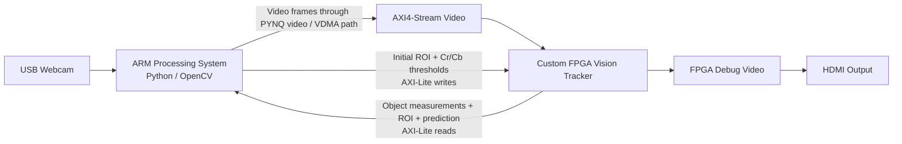
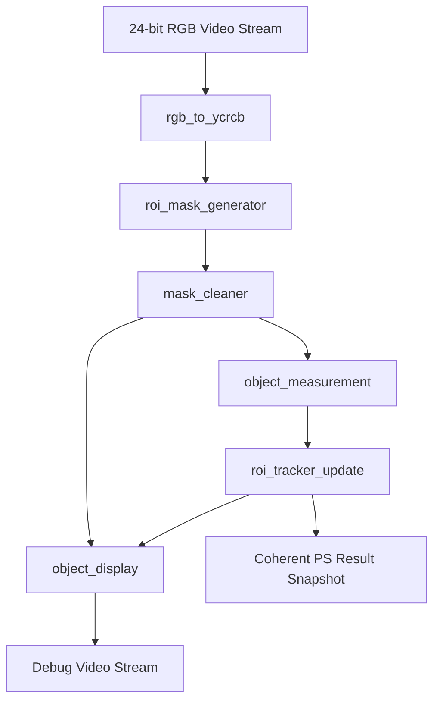
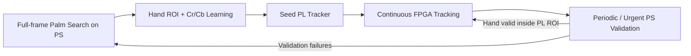

# PYNQ-Z2 FPGA-Based Real-Time Object Tracking System

A hardware/software real-time visual tracking system implemented on the **PYNQ-Z2**, with the continuous tracking loop implemented in FPGA logic.

The project combines a streaming VHDL image-processing pipeline, adaptive ROI tracking, motion prediction, loss recovery, AXI-Lite control/status, and Python-based initialization on the ARM Processing System (PS). The hardware tracker is general-purpose: it can track a user-selected object based on learned chrominance characteristics. A second operating mode uses palm detection on the PS as a reference application for automatic hand acquisition and periodic validation.

> **Primary design goal:** move the continuous, frame-by-frame tracking work into the Programmable Logic (PL), while using the PS only where software is most useful: initialization, user interaction, configuration, and optional high-level validation.

---

## Demo

> **TODO — Add main demo video/GIF here**  
> Suggested file: `docs/media/general_object_tracking.gif`  
> Recommended content: select an object, start tracking, move it normally and then quickly, and show the FPGA ROI following it.
>
> Replace this block later with:
> ``

### Debug display legend

The FPGA generates a dedicated debug video output:

- **White** — cleaned binary object mask
- **Green rectangle** — current tracking ROI
- **Red `+`** — measured object center
- **Blue `X`** — predicted object center

> **TODO — Add a clear HDMI/debug-output screenshot here**  
> Suggested file: `docs/media/hdmi_tracking_output.png`

---

## Key Features

- **FPGA-based continuous object tracking** after one initial configuration from the PS.
- **640 × 480** video processing in the current build.
- Streaming **RGB → YCrCb** conversion in VHDL.
- ROI-limited **Cr/Cb object segmentation**.
- Hardware **5 × 5 majority filter** for binary-mask cleanup.
- Per-frame hardware extraction of:
  - object centroid,
  - bounding-box width and height,
  - detected-pixel count.
- Hardware **velocity estimation and smoothing**.
- **Next-frame center prediction** and speed-dependent ROI sizing.
- Direction-aware **ROI expansion during tracking loss**.
- Coherent PS-readable tracking snapshots through **AXI-Lite**.
- Hardware-generated HDMI debug visualization.
- Two PS operating modes:
  - **General Object Tracking** — manual one-time object selection.
  - **Validated Hand Tracking** — automatic palm acquisition and asynchronous validation.
- PC-side **hardware-matched simulation** for tuning the current PL algorithm before rebuilding the FPGA design.
- Central VHDL package for frame dimensions and derived interface widths.

---

## System Architecture

The PYNQ-Z2 combines two computing domains:

- **PS — Processing System:** dual-core ARM processor running Python, OpenCV, Jupyter and the PYNQ runtime.
- **PL — Programmable Logic:** FPGA fabric running the real-time tracking pipeline written in VHDL.



The PS is therefore **not removed from the video path**: it captures the USB-camera frames and submits them to the PYNQ video pipeline. However, once tracking starts, the **tracking decisions themselves — segmentation, measurement, motion estimation, prediction, ROI movement and loss expansion — are performed by the PL**.

> **TODO — Add polished system-architecture diagram here**  
> Suggested file: `docs/media/system_architecture.png`  
> The Mermaid diagram above can remain as the editable technical version, or be replaced by the final graphic.

---

## Hardware / Software Partitioning

| Function | PS / ARM | PL / FPGA |
|---|:---:|:---:|
| USB camera capture | ✓ | |
| Initial object selection | ✓ | |
| Initial Cr/Cb threshold learning | ✓ | |
| Palm detection in validated-hand mode | ✓ | |
| Periodic high-level validation | ✓ | |
| RGB → YCrCb conversion | | ✓ |
| ROI filtering | | ✓ |
| Per-pixel object classification | | ✓ |
| Mask cleanup | | ✓ |
| Object measurement | | ✓ |
| Velocity estimation | | ✓ |
| Motion prediction | | ✓ |
| Adaptive ROI update | | ✓ |
| Lost-object ROI expansion | | ✓ |
| Debug-video generation | | ✓ |
| PS/PL configuration and status | AXI-Lite | AXI-Lite |

This partitioning keeps software flexible while placing the repetitive, deterministic tracking operations in dedicated hardware.

---

# FPGA / PL Design

## FPGA Processing Pipeline

The custom tracker is composed of a sequence of VHDL blocks:



> **TODO — Add polished FPGA pipeline figure here**  
> Suggested file: `docs/media/fpga_pipeline.png`

### 1. `rgb_to_ycrcb.vhd`

Converts each 24-bit RGB pixel to YCrCb using fixed-point integer arithmetic:

```text
Y  = ( 77R + 150G +  29B) >> 8
Cb = ((-43R - 85G + 128B) >> 8) + 128
Cr = ((128R -107G - 21B) >> 8) + 128
```

The conversion is performed in one clock stage and the final Y, Cr and Cb values are registered at the output.

Only **Cr and Cb** are required by the object-classification stage.

### 2. `roi_mask_generator.vhd`

Tracks the coordinates of the incoming raster and produces a one-bit object mask.

A pixel is classified as part of the target only when:

```text
pixel is inside the current ROI
AND cr_min <= Cr <= cr_max
AND cb_min <= Cb <= cb_max
```

Pixels outside the ROI are forced to zero. Limiting classification to the current ROI reduces the search region and prevents unrelated areas of the frame from participating in the measurement.

### 3. `mask_cleaner.vhd`

Applies a generic odd-sized majority filter to the binary mask.

The current top-level configuration uses:

```text
Kernel:              5 × 5
Window pixels:       25
Majority threshold:  13
```

The module uses line buffers and a sliding window. After the initial raster-alignment delay, it supports **one output pixel for every valid input pixel**.

The output is re-aligned to a complete frame raster so downstream blocks do not need to compensate for the filter offset.

### 4. `object_measurement.vhd`

Calculates object statistics from the cleaned mask:

- minimum and maximum X/Y coordinates,
- bounding-box width and height,
- matching-pixel count,
- centroid X and Y.

The implementation separates the work into two clocked processes:

1. A frame accumulator collects statistics for the current frame.
2. Two sequential dividers calculate centroid X and Y from the completed-frame snapshot.

While centroid division is being performed for one completed frame, the accumulator can already begin collecting the next frame.

### 5. `roi_tracker_update.vhd`

This block contains the main hardware tracking state machine.

At the end of each measured frame the tracker chooses between two paths:

#### ACCEPT

If enough matching pixels were detected, the measurement is accepted. The tracker then:

1. stores the new measured center and size,
2. calculates raw X/Y velocity,
3. clamps velocity to `±VEL_MAX`,
4. smooths velocity with the previous accepted velocity,
5. predicts the next object center,
6. increases ROI padding according to movement speed,
7. builds a tight ROI around the predicted position,
8. atomically publishes the completed tracking state.

Current velocity limit:

```text
VEL_MAX = 120 pixels/frame
```

Velocity smoothing:

```text
smoothed_velocity = (raw_velocity + previous_smoothed_velocity) / 2
```

Prediction:

```text
predicted_center = measured_center + smoothed_velocity
```

Current normal-tracking ROI parameters:

```text
Base padding:          8 px
Maximum padding:      40 px
Maximum tracking ROI: 200 × 200 px
```

Padding grows with speed:

```text
padding = clamp(PAD_BASE + abs(smoothed_velocity) / 2,
                0,
                PAD_MAX)
```

#### LOSS

If too few matching pixels are present, `tracking_lost` is asserted.

Instead of blindly making another full prediction without a new measurement, the PL expands the ROI that is already centered around the previous prediction. Expansion is **direction-aware**: more search area is added in the last known direction of motion.

The expansion also increases with consecutive missed frames through a loss ramp.

Current loss-search limits:

```text
LOSS_BASE:             10 px
LOSS_RAMP:              5 px per loss update
LOSS_MIN:               5 px
LOSS_MAX:              40 px
Maximum loss ROI:      240 × 240 px
```

The ROI therefore grows only as needed and remains bounded.

### Dynamic acceptance threshold

After an accepted object measurement, the required matching-pixel count for the next frame is derived from the measured object size:

```text
min_accepted_pixels = max(
    150,
    object_width × object_height / 8
)
```

This gives the tracker a minimum noise floor while allowing the acceptance threshold to scale with the tracked object.

### 6. `object_display.vhd`

Generates a hardware debug image with a black background and overlays the current tracking state:

- cleaned mask — white,
- ROI border — green,
- measured center — red `+`,
- predicted center — blue `X`.

The current display parameters are:

```text
ROI border thickness: 2 px
Center-marker radius: 4 px
```

### 7. `vision_tracker_logic_top.vhd`

Structurally connects the complete tracker pipeline and creates a coherent result snapshot for the PS.

All PS-facing tracking outputs are captured together only after `roi_tracker_update` has completed the frame update. A 32-bit snapshot counter is incremented whenever a new coherent result becomes available.

This allows software to determine whether a fresh result exists without reading a partially updated set of registers.

### 8. `vision_tracker_pkg.vhd`

Contains the global frame configuration and derives the internal widths required by the tracker.

Current resolution:

```vhdl
constant FRAME_WIDTH  : positive := 640;
constant FRAME_HEIGHT : positive := 480;
```

Coordinate widths, pixel-count width, centroid accumulator widths and signed prediction widths are calculated automatically from these constants.

This allows the design to be rebuilt for a different frame size without manually recalculating every interface width.

---

## Why Implement the Tracker in Hardware?

The tracking algorithm is naturally suited to an FPGA because most of the work is deterministic and stream-oriented.

### Per-pixel operations

Color conversion, ROI checking, threshold comparison and mask filtering are performed as the video stream moves through dedicated logic rather than as software loops over a frame buffer.

### Continuous streaming

The design is organized as a pipeline. After pipeline fill/alignment, the mask-cleaning path can continue to accept the raster as a stream rather than waiting for an entire frame to be processed in software.

### Frame-level work is separated from the pixel path

Object measurement and ROI-state updates occur at frame boundaries. The centroid divider operates from a stable completed-frame snapshot while accumulation for the following frame can already continue.

### Reduced PS responsibility

In general-object mode, the PS performs object selection and learns the initial chrominance thresholds. After that, the PL is responsible for the tracking state itself. The PS continues to provide video frames and may read status, but it does not calculate the moving ROI frame by frame.

---

## AXI Interfaces

The custom IP exposes two different interfaces for two different roles.

### AXI4-Stream Video

The video interface transports 24-bit RGB pixels and standard video-stream synchronization:

- `tdata` — RGB pixel data,
- `tvalid` — valid pixel,
- `tuser` — start of frame,
- `tlast` — end of line,
- `tready` — back-pressure / flow control.

The tracker produces a second AXI4-Stream carrying the generated debug video.

### AXI-Lite Control and Status

The PS controls and observes the tracker through a 32-bit AXI-Lite register interface.

Current software base address:

```text
0x43C30000
```

#### Register map

| Offset | Direction | Register | Description |
|---:|:---:|---|---|
| `0x00` | PS → PL | `TRACKING_CONTROL` | Bit 0 enables tracking |
| `0x04` | PL → PS | `TRACKING_STATUS` | Bit 0 = tracking lost |
| `0x08` | PL → PS | `SNAPSHOT_COUNTER` | Increments on each coherent published result |
| `0x0C` | PL → PS | `FRAME_WIDTH` | Hardware frame width |
| `0x10` | PL → PS | `FRAME_HEIGHT` | Hardware frame height |
| `0x14` | PS → PL | `INITIAL_ROI_X` | Initial ROI X |
| `0x18` | PS → PL | `INITIAL_ROI_Y` | Initial ROI Y |
| `0x1C` | PS → PL | `INITIAL_ROI_WIDTH` | Initial ROI width |
| `0x20` | PS → PL | `INITIAL_ROI_HEIGHT` | Initial ROI height |
| `0x24` | PS → PL | `OBJECT_THRESHOLDS` | Packed Cr/Cb bounds |
| `0x28` | PL → PS | `OBJECT_CENTER_X` | Measured centroid X |
| `0x2C` | PL → PS | `OBJECT_CENTER_Y` | Measured centroid Y |
| `0x30` | PL → PS | `OBJECT_WIDTH` | Measured object width |
| `0x34` | PL → PS | `OBJECT_HEIGHT` | Measured object height |
| `0x38` | PL → PS | `OBJECT_PIXEL_COUNT` | Number of matching pixels |
| `0x3C` | PL → PS | `TRACKING_ROI_X` | Current ROI X |
| `0x40` | PL → PS | `TRACKING_ROI_Y` | Current ROI Y |
| `0x44` | PL → PS | `TRACKING_ROI_WIDTH` | Current ROI width |
| `0x48` | PL → PS | `TRACKING_ROI_HEIGHT` | Current ROI height |
| `0x4C` | PL → PS | `PREDICTED_CENTER_X` | Signed predicted X |
| `0x50` | PL → PS | `PREDICTED_CENTER_Y` | Signed predicted Y |

The four 8-bit object thresholds are packed into `0x24` as:

```text
bits  7:0   = Cr min
bits 15:8   = Cr max
bits 23:16  = Cb min
bits 31:24  = Cb max
```

### Coherent snapshot reads

`fpga.py` reads the snapshot counter before and after the complete status-register group. If the counter changes during the read, software retries so that the returned `TrackingData` corresponds to one coherent PL snapshot.

The number of retries is bounded so software cannot be permanently blocked by a rapidly updating producer.

---

## Vivado Integration

The tracking logic is packaged as a custom IP containing:

- AXI4-Stream video input,
- processed/debug video output,
- AXI-Lite register interface,
- the complete VHDL tracking pipeline.

The repository includes the generated PYNQ overlay files:

```text
PL/design_1.bit
PL/design_1.hwh
```

> **TODO — Add Vivado Block Design screenshot here**  
> Suggested file: `docs/media/vivado_block_design.png`  
> Make sure the screenshot clearly shows the Zynq PS, video/VDMA path, custom tracking IP, AXI-Lite connection and HDMI output path.

---

# Operating Modes

## 1. General Object Tracking

Directory:

```text
PS/GENERAL_OBJECT_TRACKING/
```

Main runtime:

```text
run_object_tracker_pynq.py
```

This is the cleanest demonstration of the hardware tracker.

### Flow

1. The PS displays the live USB-camera preview.
2. The user captures one frame.
3. The user draws an initial ROI around the target object.
4. The PS learns Cr/Cb limits from the central region of that selected object.
5. The PS writes the initial ROI and thresholds to the FPGA once.
6. Tracking is enabled.
7. The PL continuously performs object segmentation, measurement, velocity estimation, prediction, ROI movement and loss recovery.

The current initialization algorithm uses:

```text
Central ROI fraction:      0.72
Low percentile:            5%
High percentile:          95%
Cr/Cb margin:               6
Minimum color samples:     10
```

The purpose of the percentile limits is to reject color outliers before expanding the final Cr/Cb range by the configured margin.

> **TODO — Add general-object demo GIF/video here**  
> Suggested file: `docs/media/general_object_tracking.gif`

---

## 2. Validated Hand Tracking

Directory:

```text
PS/VALIDATED_HAND_TRACKING/
```

Main runtime:

```text
run_tracker.py
```

This mode demonstrates how the same hardware tracker can be combined with a higher-level software detector.

The included `palm.onnx` model is used for **acquisition and validation**, not for continuous frame-by-frame tracking.

### Flow



The PS:

1. finds a hand using `palm.onnx`,
2. derives an ROI and Cr/Cb thresholds,
3. seeds the PL tracker,
4. performs asynchronous validation approximately once per second,
5. requests urgent validation when a fresh PL snapshot reports `tracking_lost = 1`.

Healthy tracking is intentionally left alone: a successful validation does **not** continuously overwrite the PL ROI.

Palm inference runs in a background worker so it does not block the camera-to-video-to-PL path.

Current validation interval:

```text
1.0 second
```

> **TODO — Add validated-hand demo video/GIF here**  
> Suggested file: `docs/media/validated_hand_tracking.gif`

---

# Hardware Setup

## Required Hardware

- **PYNQ-Z2** development board
- **USB webcam**
- **Ethernet cable** between the PYNQ-Z2 and the computer
- USB cable for the board's serial/UART connection
- Computer running Windows
- PYNQ-compatible SD card/image
- Optional but recommended for the hardware debug view:
  - HDMI cable
  - HDMI monitor/display

## Required Software

On the computer:

- PuTTY or another serial terminal
- Web browser

On the PYNQ image / runtime:

- PYNQ Python environment
- OpenCV (`cv2`)
- NumPy
- Jupyter / IPython widgets used by the interactive interface

The validated-hand mode also uses OpenCV DNN to load the included `palm.onnx` model.

---

# Connecting to the PYNQ-Z2

The following procedure is intended for a direct Ethernet connection between a Windows computer and the PYNQ-Z2.

## Step 1 — Find the COM Port

1. Connect the PYNQ-Z2 to the computer through its serial/UART USB connection.
2. Press **Windows + X**.
3. Open **Device Manager**.
4. Open **Ports (COM & LPT)**.
5. Identify the COM port assigned to the PYNQ-Z2, for example:

```text
COM3
```

The exact COM number may be different on every computer.

## Step 2 — Open a Serial Session in PuTTY

Open PuTTY and configure:

```text
Connection type: Serial
Serial line:     COMx
Speed:           115200
```

Replace `COMx` with the COM port found in Device Manager.

Click **Open**.

Press **Enter** until the PYNQ terminal prompt appears, then run:

```bash
ifconfig eth0
```

Find the IPv4 address shown next to `inet`.

For example:

```text
inet 192.168.2.99
```

In this example the board's Ethernet address is:

```text
192.168.2.99
```

## Step 3 — Configure the Computer's Ethernet Address

Open the Windows settings for the Ethernet adapter and configure IPv4 manually.

The computer and PYNQ-Z2 must be on the **same subnet**, but they must **not use the same IP address**.

For example, if the board reports:

```text
PYNQ-Z2: 192.168.2.99
```

configure the computer as:

```text
IP address:  192.168.2.1
Subnet mask: 255.255.255.0
Gateway:     leave blank
DNS:         leave blank
```

So the direct connection becomes:

```text
Computer: 192.168.2.1
PYNQ-Z2:  192.168.2.99
```

If the board reports a different subnet, choose a free computer address in that same subnet instead.

## Step 4 — Open the PYNQ Web Interface

In a browser, open:

```text
http://pynq:9090
```

If prompted for the default PYNQ password:

```text
xilinx
```

If the hostname `pynq` does not resolve, use the board IP found with `ifconfig`, for example:

```text
http://192.168.2.99:9090
```

---

# Running the Project on the Board

## Prepare the Overlay Files

Both runtime scripts expect the matching `.bit` and `.hwh` files to be **in the same directory as the Python runtime**.

The repository stores the master copies under:

```text
PL/design_1.bit
PL/design_1.hwh
```

Before running a mode, place both files next to that mode's script.

### General Object Tracking directory should contain

```text
PS/GENERAL_OBJECT_TRACKING/
├── fpga.py
├── run_object_tracker_pynq.py
├── design_1.bit
└── design_1.hwh
```

### Validated Hand Tracking directory should contain

```text
PS/VALIDATED_HAND_TRACKING/
├── fpga.py
├── mp_palmdet.py
├── palm.onnx
├── run_tracker.py
├── design_1.bit
└── design_1.hwh
```

The `.bit` and `.hwh` files must be the matching pair generated from the same Vivado design.

---

## Run General Object Tracking

Open a Jupyter notebook in:

```text
PS/GENERAL_OBJECT_TRACKING/
```

Run:

```python
%matplotlib notebook
from run_object_tracker_pynq import PYNQObjectTracker

tracker = PYNQObjectTracker()
tracker.run_interactive()
```

### User flow

1. Wait for the live camera preview.
2. Click **CAPTURE FRAME**.
3. Draw a rectangle around the object to track.
4. Confirm the ROI and start tracking.
5. Observe the live PL status and hardware debug output.
6. Use **STOP & CLOSE** for a clean shutdown.

Once tracking has started, the continuous tracker is running in the PL.

---

## Run Validated Hand Tracking

Open a Jupyter notebook in:

```text
PS/VALIDATED_HAND_TRACKING/
```

Run:

```python
%run run_tracker.py
```

The runtime automatically starts full-frame hand search. After a valid hand is acquired, it learns the hand's chrominance limits, seeds the FPGA tracker and enters continuous PL tracking with periodic PS validation.

---

# Hardware-Matched PC Simulation

The repository also contains:

```text
full_system_simulation.py
```

The simulator reproduces the current tracking algorithm at frame level and is intended for algorithm tuning before committing new constants to VHDL and rebuilding the FPGA design.

It models:

```text
rgb_to_ycrcb
      ↓
roi_mask_generator
      ↓
mask_cleaner
      ↓
object_measurement
      ↓
roi_tracker_update
      ↓
object_display
```

The default `HWConfig` values match the current VHDL top-level configuration.

### Run with a webcam

```bash
python full_system_simulation.py
```

or choose another camera:

```bash
python full_system_simulation.py --camera 1
```

### Run with a recorded video

```bash
python full_system_simulation.py --video path/to/video.mp4
```

### Controls

```text
S       Select / reselect object
R       Reset tracking
Q / ESC Quit
```

The simulator opens two useful windows:

- **SIM DEBUG** — original camera image plus diagnostic information.
- **REAL SYSTEM - exact PL HDMI** — software rendering of the expected hardware debug output.

> **TODO — Add simulation screenshot here**  
> Suggested file: `docs/media/hardware_matched_simulation.png`

This simulation was used as a development tool for changing tracking parameters quickly before transferring the selected values back into the VHDL implementation.

---

# Current Hardware Configuration

| Parameter | Current value |
|---|---:|
| Frame width | 640 px |
| Frame height | 480 px |
| Mask-cleaner kernel | 5 × 5 |
| Majority threshold | 13 / 25 |
| Velocity limit (`VEL_MAX`) | 120 px/frame |
| Normal ROI base padding | 8 px |
| Normal ROI maximum padding | 40 px |
| Maximum normal-tracking ROI | 200 × 200 px |
| Pixel-count floor | 150 |
| Pixel-count area divisor | 8 |
| Loss base expansion | 10 px |
| Loss ramp | 5 px/update |
| Loss expansion clamp | 5–40 px |
| Maximum loss ROI | 240 × 240 px |
| Debug ROI border | 2 px |
| Center-marker radius | 4 px |

---

# FPGA Implementation Results

This section should contain the final post-implementation Vivado results rather than estimated values.

| Metric | Result |
|---|---:|
| FPGA device | Zynq-7000 on PYNQ-Z2 |
| Video resolution | 640 × 480 |
| PL clock frequency | **TODO** |
| Measured / configured video frame rate | **TODO** |
| LUT utilization | **TODO** |
| LUTRAM utilization | **TODO** |
| Flip-Flop utilization | **TODO** |
| BRAM utilization | **TODO** |
| DSP utilization | **TODO** |
| WNS | **TODO** |
| TNS | **TODO** |
| Timing met | **TODO** |

> **TODO — Add Vivado utilization screenshot here**  
> Suggested file: `docs/media/vivado_utilization.png`

> **TODO — Add Vivado timing summary screenshot here**  
> Suggested file: `docs/media/vivado_timing_summary.png`

Do not replace the table with screenshots alone. The screenshots provide evidence, while the table makes the important engineering results immediately readable.

---

# Repository Structure

```text
pynq_z2_object_tracking_system/
│
├── PL/
│   ├── design_1.bit
│   ├── design_1.hwh
│   │
│   ├── hdl/
│   │   ├── vision_tracker_ip.vhd
│   │   └── vision_tracker_ip_slave_lite_v1_0_S_AXI_TRACK.vhd
│   │
│   └── src/
│       ├── mask_cleaner.vhd
│       ├── object_display.vhd
│       ├── object_measurement.vhd
│       ├── rgb_to_ycrcb.vhd
│       ├── roi_mask_generator.vhd
│       ├── roi_tracker_update.vhd
│       ├── vision_tracker_logic_top.vhd
│       └── vision_tracker_pkg.vhd
│
├── PS/
│   ├── GENERAL_OBJECT_TRACKING/
│   │   ├── fpga.py
│   │   └── run_object_tracker_pynq.py
│   │
│   └── VALIDATED_HAND_TRACKING/
│       ├── fpga.py
│       ├── mp_palmdet.py
│       ├── palm.onnx
│       └── run_tracker.py
│
├── full_system_simulation.py
└── README.md
```

---

# Main Source Files

## PL

### `vision_tracker_pkg.vhd`
Global frame constants, tracker-wide interface parameters and automatically derived bit widths.

### `rgb_to_ycrcb.vhd`
Fixed-point RGB-to-YCrCb conversion.

### `roi_mask_generator.vhd`
Raster position tracking, ROI filtering and Cr/Cb object classification.

### `mask_cleaner.vhd`
Streaming majority filter with line buffers and output-raster alignment.

### `object_measurement.vhd`
Frame accumulation, bounding box, pixel count and centroid calculation.

### `roi_tracker_update.vhd`
Adaptive ROI controller, velocity estimation, motion prediction and loss recovery.

### `object_display.vhd`
Hardware debug visualization.

### `vision_tracker_logic_top.vhd`
Structural integration of the complete tracking pipeline and coherent PS snapshot publication.

### `vision_tracker_ip.vhd`
Custom-IP wrapper combining the tracking core with AXI4-Stream video and AXI-Lite control/status.

### `vision_tracker_ip_slave_lite_v1_0_S_AXI_TRACK.vhd`
AXI-Lite register implementation.

## PS

### `fpga.py`
Software side of the AXI-Lite contract. Loads the PYNQ overlay, writes configuration registers and reads coherent tracking snapshots.

### `run_object_tracker_pynq.py`
General-purpose object-tracking runtime. The PS initializes the tracker; the PL performs continuous tracking.

### `run_tracker.py`
Validated-hand runtime combining FPGA tracking with asynchronous palm detection/validation.

### `mp_palmdet.py`
OpenCV-DNN wrapper and post-processing for the included palm ONNX model.

## Simulation

### `full_system_simulation.py`
PC-side functional model of the current PL tracking algorithm and visualization behavior.

---

# Design Notes

## One Source of Truth for the PS/PL Register Contract

The VHDL register interface defines the hardware contract. The offsets and threshold packing in `fpga.py` mirror that interface and must be changed together if the register map is modified.

## Coherent Results Instead of Torn Reads

A snapshot counter accompanies the PS-facing result registers. Software checks that the counter remains unchanged across a complete read so object center, size, ROI, prediction and loss state belong to the same published hardware result.

## Tracking ROI Is Maintained in the PL

The PS does not calculate a new ROI every frame in general-object mode. This is a core architectural decision of the project: the ROI controller itself is implemented in VHDL.

## Resolution-Dependent Widths Are Derived Automatically

Changing `FRAME_WIDTH` and `FRAME_HEIGHT` in `vision_tracker_pkg.vhd` recalculates coordinate, pixel-count, accumulator and prediction widths at elaboration time.

---

# Limitations

The current tracker is intentionally lightweight and hardware-oriented. Its main limitations are:

- The target is represented primarily by **Cr/Cb chrominance ranges**, so a visually similar object entering the active ROI may also match.
- Large illumination or appearance changes can make the original learned threshold range less representative.
- Normal tracking and loss-recovery ROI sizes are intentionally bounded.
- The current implementation tracks one target at a time.
- General-object initialization still requires the user to select the first ROI.
- In validated-hand mode, palm acquisition/validation is a PS-side neural-network operation rather than an FPGA accelerator.
- USB-camera capture is handled by the PS; the project accelerates the tracking pipeline rather than implementing a direct sensor-to-FPGA camera interface.

---

# Future Work

Possible extensions include:

- automatic threshold adaptation while the object appearance changes,
- multiple-object tracking,
- additional hardware features beyond chrominance,
- direct camera-to-PL streaming,
- higher resolutions and additional video formats,
- deeper pipelining / resource optimization after timing analysis,
- FPGA acceleration of the acquisition/validation neural network,
- improved confidence scoring for ambiguous object masks,
- runtime-adjustable tracker parameters through additional AXI-Lite registers.

---

# Media Still to Add

Before the final public release, add the following media:

1. **Main tracking GIF/video** — the strongest visual demonstration of the project.
2. **Physical hardware setup photo** — PYNQ-Z2, USB camera, Ethernet and optional HDMI display.
3. **FPGA debug-output screenshot** — white mask, green ROI, red measured center, blue prediction.
4. **Vivado Block Design screenshot** — clearly showing the custom tracking IP in the complete Zynq/video design.
5. **Polished architecture diagram** — PS/PL and data/control paths.
6. **Polished FPGA pipeline diagram** — the VHDL processing stages.
7. **Validated-hand tracking demo**.
8. **Hardware-matched PC simulation screenshot**.
9. **Vivado utilization report**.
10. **Vivado timing summary**.

Recommended folder:

```text
docs/
└── media/
    ├── general_object_tracking.gif
    ├── hardware_setup.jpg
    ├── hdmi_tracking_output.png
    ├── vivado_block_design.png
    ├── system_architecture.png
    ├── fpga_pipeline.png
    ├── validated_hand_tracking.gif
    ├── hardware_matched_simulation.png
    ├── vivado_utilization.png
    └── vivado_timing_summary.png
```

---

# Academic Project

This repository was developed as an academic final project focused on **FPGA-based real-time computer vision and hardware/software co-design using the PYNQ-Z2 platform**.

**Authors:** TODO  
**Institution:** TODO  
**Department:** TODO  
**Academic year:** 2026

---

## Summary

The project demonstrates a complete hardware/software vision-tracking architecture rather than only a software computer-vision application. The ARM processor is used for flexible initialization and optional high-level validation, while the FPGA implements the continuous tracking loop: pixel classification, filtering, measurement, motion estimation, prediction, adaptive ROI control, loss recovery and debug-video generation.

The result is a modular platform for experimenting with real-time object tracking on the PYNQ-Z2 and for studying the engineering trade-offs between software flexibility and dedicated FPGA processing.
