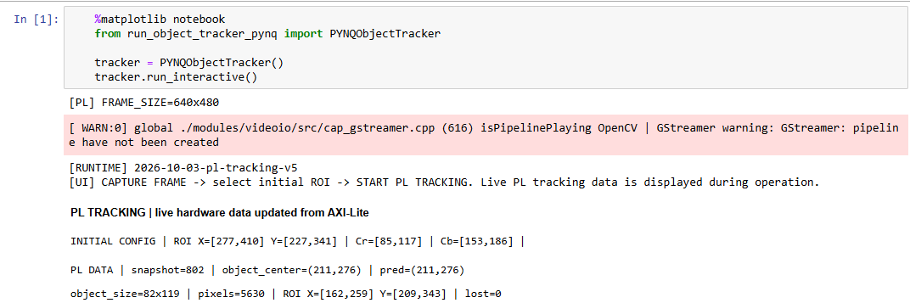
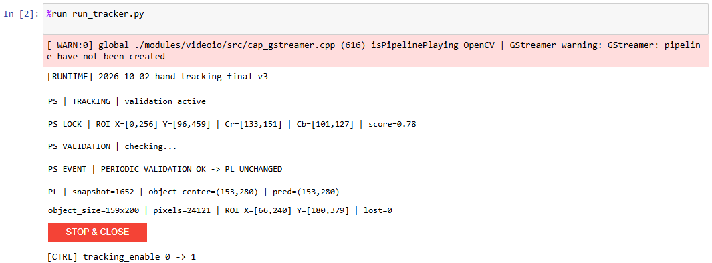
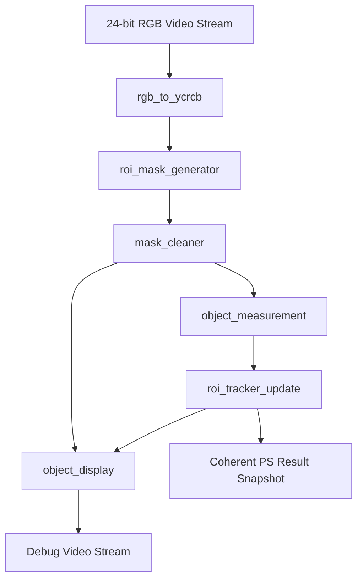
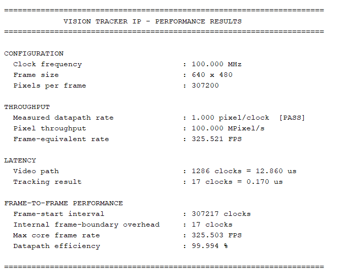
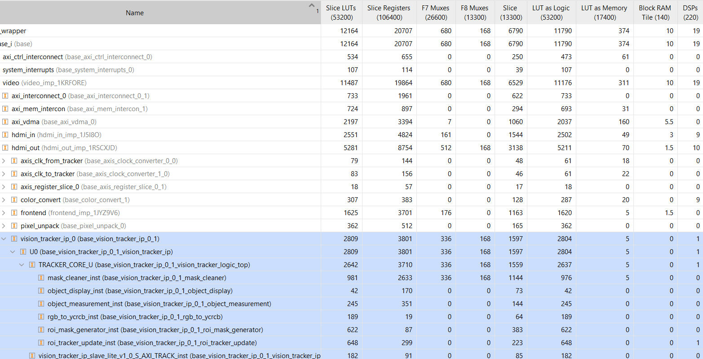

# PYNQ-Z2 FPGA Based Real-Time Object Tracking System

An **FPGA-based real-time object tracking system** implemented on the **PYNQ-Z2**.

The core of the system is a **custom VHDL tracking engine** running entirely in the FPGA's **Programmable Logic (PL)**. Once initialized, the FPGA performs the complete frame-by-frame tracking process in hardware, including object segmentation, mask filtering, object measurement, centroid calculation, motion estimation, prediction of the object's next position, adaptive ROI control, loss detection and recovery, and debug-video generation.

The **Processing System (PS)** is responsible for camera interfacing, frame delivery, initialization, configuration, user interaction, optional high-level supervision, and displaying the tracking information received from the PL.

The project includes **two software operating modes**, both using the same hardware tracker:

- **General Object Tracking** - the user selects an object once, and the PS learns the initial color thresholds and provides the initial ROI. From that point, the **FPGA performs the complete continuous tracking process autonomously**.

- **Validated Hand Tracking** - demonstrates how an **AI model can be combined with the hardware tracker**. A palm-detection model running on the PS is used to acquire a hand and periodically validate that the FPGA is still tracking the correct target.


## System Architecture and Vivado Integration

The tracking system is built on the **PYNQ-Z2 Base Overlay video pipeline**, which was adapted and extended to incorporate a custom Vivado IP core, `vision_tracker_ip`, directly into the hardware video-processing path.

The custom IP provides:

- AXI4-Stream video input (`S_AXIS_VIDEO`),
- processed/debug AXI4-Stream video output (`VIDEO_OUT`),
- AXI-Lite control/status interface (`S_AXI_TRACK`),
- and the complete internal VHDL tracking pipeline.

### Custom Tracker Integration into the Video Pipeline

<p align="center">
  
</p>

The figure above shows the actual Vivado integration of `vision_tracker_ip_0` inside the HDMI output subsystem, where the custom tracker is inserted **in-line in the FPGA video stream** so that incoming pixels pass directly through the hardware tracking pipeline.

The surrounding blocks perform the following functions:

1. **`pixel_unpack`** - converts the incoming packed video stream to the 24-bit pixel format used by the processing path.
2. **`axis_register_slice_0`** - provides an AXI4-Stream register stage before the tracker.
3. **`axis_clk_to_tracker`** - transfers the video stream from the **142 MHz HDMI/video clock domain** into the dedicated **100 MHz tracking domain**.
4. **`vision_tracker_ip_0`** - executes the VHDL tracking pipeline and updates the tracking data.
5. **`axis_clk_from_tracker`** - transfers the processed stream from the tracking domain back to the **142 MHz HDMI/video clock domain**..
6. **`color_convert and HDMI frontend`** - Convert the video stream to the required output format and drive the physical HDMI output of the board.

### AXI Interfaces

The custom `vision_tracker_ip` uses two AXI interfaces with separate roles:

- **AXI4-Stream** - transports the video stream through the hardware tracking pipeline.
- **AXI-Lite** - provides configuration and status communication between the PS and the tracker.

#### AXI4-Stream Video

The `S_AXIS_VIDEO` interface transports 24-bit RGB pixels together with the standard AXI4-Stream video control signals:

- `tdata` - RGB pixel data,
- `tvalid` - indicates that the current pixel data is valid and ready to be transferred,
- `tuser` - start of frame,
- `tlast` - end of line,
- `tready` - indicates that the receiving block is ready to accept the current pixel, enabling AXI4-Stream flow control.

#### AXI-Lite Control and Status

The PS configures and observes the tracker through the 32-bit `S_AXI_TRACK` AXI-Lite interface.

The tracker is memory-mapped at:

```text
0x43C30000
```
##### Register Map

| Offset | Direction | Register | Description |
|---:|:---:|---|---|
| `0x00` | PS → PL | `TRACKING_CONTROL` | Bit 0 enables tracking |
| `0x14` | PS → PL | `INITIAL_ROI_X` | Initial ROI X |
| `0x18` | PS → PL | `INITIAL_ROI_Y` | Initial ROI Y |
| `0x1C` | PS → PL | `INITIAL_ROI_WIDTH` | Initial ROI width |
| `0x20` | PS → PL | `INITIAL_ROI_HEIGHT` | Initial ROI height |
| `0x24` | PS → PL | `OBJECT_THRESHOLDS` | Packed Cr/Cb bounds |
| `0x04` | PL → PS | `TRACKING_STATUS` | Bit 0: 0 = Not lost, 1 = Tracking lost |
| `0x08` | PL → PS | `SNAPSHOT_COUNTER` | Increments on each coherent published result |
| `0x0C` | PL → PS | `FRAME_WIDTH` | Hardware frame width |
| `0x10` | PL → PS | `FRAME_HEIGHT` | Hardware frame height |
| `0x28` | PL → PS | `OBJECT_CENTER_X` | Measured centroid X |
| `0x2C` | PL → PS | `OBJECT_CENTER_Y` | Measured centroid Y |
| `0x30` | PL → PS | `OBJECT_WIDTH` | Measured object width |
| `0x34` | PL → PS | `OBJECT_HEIGHT` | Measured object height |
| `0x38` | PL → PS | `OBJECT_PIXEL_COUNT` | Number of matching pixels |
| `0x3C` | PL → PS | `TRACKING_ROI_X` | Current ROI X |
| `0x40` | PL → PS | `TRACKING_ROI_Y` | Current ROI Y |
| `0x44` | PL → PS | `TRACKING_ROI_WIDTH` | Current ROI width |
| `0x48` | PL → PS | `TRACKING_ROI_HEIGHT` | Current ROI height |
| `0x4C` | PL → PS | `PREDICTED_CENTER_X` | Signed predicted X |
| `0x50` | PL → PS | `PREDICTED_CENTER_Y` | Signed predicted Y |

The four 8-bit object thresholds are packed into `OBJECT_THRESHOLDS` (`0x24`) as:

```text
bits  7:0   = Cr min
bits 15:8   = Cr max
bits 23:16  = Cb min
bits 31:24  = Cb max
```

##### PS-PL Software Interface (`fpga.py`)

The `fpga.py` module serves as the **software interface between the PS applications and the hardware tracker in the PL**, providing a set of ready-to-use functions for communication through AXI-Lite.

Instead of directly accessing hardware registers, the main PS applications simply call the appropriate functions from `fpga.py` to send configuration parameters, control the tracker, or retrieve tracking results. The module handles the underlying register addresses, data formatting, and memory-mapped communication.

Its main responsibilities include:

- **FPGA initialization** - loads the FPGA overlay and establishes register access using PYNQ's `Overlay` and `MMIO` APIs, through the `FPGA()` constructor.
- **Tracker configuration** - transfers the initial ROI coordinates and Cr/Cb color thresholds to the PL, using `write_initial_roi()` and `write_object_thresholds()`.
- **Tracker control** - enables or disables hardware tracking through `set_tracking_enable()`.
- **Tracking data retrieval** - reads the object position, dimensions, pixel count, current ROI, predicted center, and tracking-loss status, using `read_tracking_data()`, which returns the results as a structured `TrackingData` object.
- **Data consistency** - detects changes in the `SNAPSHOT_COUNTER` during register reads and retries when necessary, as part of `read_tracking_data()`.

This abstraction allows the main PS applications to focus on their own functionality while `fpga.py` handles the low-level control and status communication with the PL. 

# Operating Modes

## 1. General Object Tracking

Directory:

```text
PS/GENERAL_OBJECT_TRACKING/
```

Main runtime:

```text
run_object_tracker_pynq.py
```

This is the cleanest demonstration of the hardware tracker.

### Flow

1. The PS displays the live USB-camera preview.
2. The user captures one frame.
3. The user draws an initial ROI around the target object.
4. The PS learns Cr/Cb limits from the central region of that selected object.
5. The PS writes the initial ROI and thresholds to the FPGA.
6. Tracking is enabled.
7. From this point, the PS continues to deliver video frames, but **the continuous tracking state is owned by the PL**.


The initialization behavior is controlled by the following parameters:

| Parameter | Purpose |
|---|---|
| `Central ROI fraction` | Defines how much of the center of the user-selected ROI is used for color sampling |
| `Low percentile` | Defines the lower percentile used when estimating the Cr/Cb range |
| `High percentile` | Defines the upper percentile used when estimating the Cr/Cb range |
| `Cr/Cb margin` | Expands the learned Cr/Cb limits after percentile filtering |
| `Minimum color samples` | Defines the minimum number of valid color samples required to estimate the initial Cr/Cb range |

The percentile limits reduce the influence of color outliers, while the Cr/Cb margin provides additional tolerance around the learned object-color range.

### Initial ROI selection examples

The general-object mode begins with a one-time user selection of the target ROI. The PS then learns the initial Cr/Cb range from the selected object and seeds the hardware tracker.

<table>
  <tr>
    <td width="50%" align="center"></td>
    <td width="50%" align="center"></td>
  </tr>
  <tr>
    <td align="center"><b>Initial ROI — Example 1</b></td>
    <td align="center"><b>Initial ROI — Example 2</b></td>
  </tr>
</table>

### Live PL tracking data

During operation, the notebook can display the current hardware state read from the tracker through AXI-Lite, including the published snapshot number, measured object center and size, pixel count, current ROI, predicted center and loss state.

<p align="center">
  
</p>

### HDMI Tracking Display

<p align="center">
  
  
</p>

<p align="center"><i>Two examples of the general-purpose FPGA tracker following different user-selected objects.</i></p>

---

## 2. Validated Hand Tracking

Directory:

```text
PS/VALIDATED_HAND_TRACKING/
```

Main runtime:

```text
run_tracker.py
```

This mode demonstrates how the same hardware tracker can be combined with a higher-level software detector for acquisition and periodic validation.

### Flow

1. The PS searches the full frame for a hand using `palm.onnx`.
2. Once a hand is detected, the PS defines an initial ROI and learns the corresponding Cr/Cb thresholds.
3. The PS writes the initial ROI and thresholds to the FPGA.
4. Tracking is enabled.
5. From this point, **continuous tracking is performed by the PL**.
6. The PS periodically validates that the tracked hand is still located inside the ROI reported by the PL.
7. A fresh PL snapshot reporting `tracking_lost = 1` trigger an immediate validation.
8. If validation confirms that the hand is still correctly tracked, the PL continues without its ROI being overwritten.
9. If validation fails repeatedly, the PS returns to full-frame hand acquisition and reinitializes the hardware tracker.

The validation behavior is designed so that the software detector supervises the tracker without replacing the continuous hardware tracking loop.

A successful validation does **not** continuously update the PL ROI. As long as tracking remains valid, the ROI continues to be calculated and updated by the hardware.

Palm inference runs in a background worker so that validation does not block the camera-to-video-to-PL processing path.

The PS-side behavior is configurable, including the validation frequency, detector confidence requirements, ROI-overlap requirements, recovery sensitivity, and the parameters used to define and calibrate the initial hand ROI.

### PS/PL validation status

During operation, the notebook displays the interaction between the software validator and the continuously running PL tracker.

The status output includes PS acquisition and validation events together with the current FPGA snapshot, ROI, measured object state and tracking-loss status.

<p align="center">
  
</p>

### HDMI Tracking Display

<p align="center">
  
</p>

<p align="center"><i>The FPGA tracker following the detected hand while the PS performs acquisition and periodic high-level validation.</i></p>


## FPGA / PL Design

The FPGA implements a complete frame-to-frame tracking feedback loop. For each frame, the PL measures the object, estimates its motion, predicts its next position, and uses the predicted position and motion information to determine the ROI for the following frame.

### FPGA Processing Pipeline

The tracking engine is implemented as a sequence of dedicated VHDL blocks:



### 1. `rgb_to_ycrcb.vhd`

Converts each 24-bit RGB pixel to YCrCb using fixed-point integer arithmetic:

```text
Y  = ( 77R + 150G +  29B) >> 8
Cb = ((-43R - 85G + 128B) >> 8) + 128
Cr = ((128R -107G - 21B) >> 8) + 128
```

Object classification is based exclusively on the **Cr and Cb chrominance components** of the YCrCb color space. The **Y (luminance) component is excluded from the tracking process**, making the system less sensitive to changes in lighting conditions.

### 2. `roi_mask_generator.vhd`

Tracks the coordinates of the incoming raster and produces a one-bit object mask.

A pixel is classified as part of the target only when:

```text
pixel is inside the current ROI
AND cr_min <= Cr <= cr_max
AND cb_min <= Cb <= cb_max
```

Pixels outside the ROI are forced to zero. Limiting classification to the current ROI reduces the search region and prevents unrelated areas of the frame from participating in the measurement.


### 3. `mask_cleaner.vhd`

Cleans the binary object mask using a generic odd-sized **K × K majority filter**.

For any odd kernel size `K`:

```text
Kernel:              K × K
Window pixels:       K²
Majority threshold:  (K² + 1) / 2
```

For each pixel, the module examines the corresponding `K × K` neighborhood. The output pixel is set to `1` when at least `(K² + 1) / 2` pixels in the window are `1`; otherwise, it is set to `0`.

This removes isolated mask noise while preserving regions where object-classified pixels form a local majority.

The module uses **line buffers and a sliding window** for continuous raster processing. After the initial raster-alignment delay, it supports **one output pixel for every valid input pixel**.

### 4. `object_measurement.vhd`

Calculates the position, size, and center of the detected object from the cleaned binary mask.

As each valid pixel arrives, every pixel classified as part of the object contributes to running measurements:

```text
pixel_count -   Number of matching pixels

sum_x -         Sum of the X coordinates of all matching pixels
sum_y -         Sum of the Y coordinates of all matching pixels

min_x / max_x - Leftmost and rightmost matching-pixel coordinates
min_y / max_y - Topmost and bottommost matching-pixel coordinates
```

The coordinate limits define the object's bounding box:

```text
object_width  = max_x - min_x + 1
object_height = max_y - min_y + 1
```

The accumulated coordinate sums are used to calculate the object centroid:

```text
centroid_x = sum_x / pixel_count
centroid_y = sum_y / pixel_count
```

The centroid therefore represents the average position of all matching object pixels, rather than simply the geometric center of the bounding box.

The implementation separates the work into two clocked processes:

1. A frame accumulator updates `pixel_count`, `sum_x`, `sum_y`, `min_x`, `max_x`, `min_y`, and `max_y` continuously as matching pixels arrive.
2. At the end of the frame, the accumulated values are captured as a completed-frame snapshot. The X and Y centroid coordinates are then calculated in parallel, while the division operations required for `centroid_x` and `centroid_y` are distributed over multiple clock cycles to reduce the combinational path and help the design meet timing requirements.
   
While centroid division is being performed for the completed frame, the accumulator can already begin processing pixels from the next frame.

### 5. `roi_tracker_update.vhd`

This block contains the main hardware tracking state machine.

At the end of each measured frame, the tracker first determines whether the new object measurement is reliable enough to use.

#### Measurement acceptance decision

The decision is made by comparing the number of pixels classified as part of the object against a dynamic acceptance threshold, which is calculated according to the size of the object in the most recently accepted measurement.

```text
min_accepted_pixels = max(
    COUNT_FLOOR,
    previous_object_width × previous_object_height / 2^COUNT_SHIFT
)
```

The threshold is recalculated after every accepted measurement, allowing it to scale with the tracked object's size.

| Parameter | Description |
|---|---|
| `COUNT_FLOOR` | Minimum number of matching pixels required for acceptance |
| `COUNT_SHIFT` | Required ratio between the number of matching pixels and the object's bounding-box area |

This allows the required pixel count to increase with object size while maintaining a minimum threshold for smaller objects.

For each completed frame:

```text
if matching_pixel_count >= min_accepted_pixels
    → ACCEPT

else
    → LOSS
```

#### <ins>**ACCEPT**</ins>
When the measurement contains enough matching pixels, it is accepted as the new object position.

The tracker then:

1. stores the new measured center and size,
2. calculates raw X/Y velocity from the previous accepted center,
3. limits the velocity using `VEL_MAX`,
4. smooths the velocity using the previous accepted velocity,
5. predicts the next object center,
6. increases ROI padding according to movement speed,
7. builds a new ROI around the predicted position,
8. publishes the completed tracking state.

**Velocity smoothing**

```text
smoothed_velocity =
    (raw_velocity + previous_smoothed_velocity) / 2
```

**Prediction**

```text
predicted_center =
    measured_center + smoothed_velocity
```

Normal tracking behavior is controlled by the following parameters:

| Parameter | Description |
|---|---|
| `VEL_MAX` | Maximum allowed velocity |
| `PAD_BASE` | Base ROI padding |
| `PAD_MAX` | Maximum ROI padding |
| `MAX_TRACK_ROI_W` | Maximum normal-tracking ROI width |
| `MAX_TRACK_ROI_H` | Maximum normal-tracking ROI height |

The ROI padding increases with the magnitude of the object's motion:

```text
padding = clamp(
    PAD_BASE + abs(smoothed_velocity) / 2,
    0,
    PAD_MAX
)
```

This keeps the ROI relatively tight when the object is moving slowly while providing additional search space when faster motion is detected.

#### <ins>**LOSS**</ins>
When the number of matching pixels falls below `min_accepted_pixels`, the measurement is not trusted and `tracking_lost` is asserted.

Because there is no reliable new object position, the tracker does not perform another full prediction from an untrusted measurement.

Instead, it expands the ROI around the previous predicted position.

The loss search is **direction-aware**: the last accepted velocity is used to provide more search space in the direction in which the object was previously moving.

The search region grows progressively when several consecutive frames are missed.

Loss recovery behavior is controlled by the following parameters:

| Parameter | Description |
|---|---|
| `LOSS_BASE` | Base expansion applied during loss |
| `LOSS_RAMP` | Additional expansion after consecutive missed frames |
| `LOSS_MIN` | Minimum expansion |
| `LOSS_MAX` | Maximum expansion |
| `MAX_LOSS_W` | Maximum loss-search ROI width |
| `MAX_LOSS_H` | Maximum loss-search ROI height |

This allows the search area to expand gradually when tracking becomes uncertain while keeping the ROI bounded.

> **Implementation note:** The tracking logic is implemented as a multi-stage registered state machine to maintain a short combinational path between registers.


### 6. `object_display.vhd`

Generates a hardware debug view that provides a direct visual representation of the current tracking state.

The output uses a black background and displays:

- **Cleaned mask** - white
- **Active ROI border** - green
- **Measured object center** - red `+`
- **Predicted object center** - blue `X`

This makes it possible to visually verify the detected object region, the current search area, and the relationship between the measured and predicted object positions directly from the hardware output.

### 7. `vision_tracker_logic_top.vhd`

Structurally connects the complete tracker pipeline and creates a coherent result snapshot for the PS.

All PS-facing tracking outputs are captured together only after `roi_tracker_update` has completed the frame update. A 32-bit snapshot counter is incremented whenever a new coherent result becomes available.

This allows software to determine whether a fresh result exists without reading a partially updated set of registers.

### 8. `vision_tracker_pkg.vhd`

`vision_tracker_pkg.vhd` is the central compile-time configuration package for resolution-dependent tracker parameters.

Current configuration:

```vhdl
constant FRAME_WIDTH  : positive := 640;
constant FRAME_HEIGHT : positive := 480;
constant VEL_MAX      : positive := 120;
```

These parameters define the frame dimensions and the maximum supported tracking velocity.

From them, the package automatically derives the internal bit widths required throughout the hardware design, including:

- X/Y coordinate widths,
- ROI dimension widths,
- full-frame pixel-count width,
- X/Y centroid accumulator widths,
- signed predicted-center widths.

The derived widths automatically scale with the configured frame dimensions. For example, the centroid accumulators are sized to hold the maximum possible sum of matching-pixel coordinates across a complete frame.

The predicted-center representation also accounts for `VEL_MAX`, allowing predicted positions to temporarily extend beyond the visible frame boundaries without overflowing the internal representation.

The package provides helper functions used to calculate these widths at elaboration time:

```text
clog2()
    Determines the number of bits required to represent a given range.

coordinate_sum_bits()
    Determines the number of bits required for the centroid coordinate accumulators.
```

This centralizes the resolution-dependent configuration and allows the hardware to be adapted to a different frame size without manually recalculating signal widths throughout the individual VHDL modules.


# FPGA Implementation Results

The final Vivado implementation confirms that the complete system including the PYNQ video infrastructure and the custom hardware tracker fits comfortably in the Zynq-7000 device and meets the specified timing constraints.

## Timing Closure

Post-implementation Vivado analysis confirmed that **all user-specified timing constraints are met**, with no failing setup or hold endpoints.

Timing closure was treated as an architectural requirement throughout the VHDL design. Computationally intensive operations were therefore divided across registered stages rather than implemented as long combinational paths.

For example, in `roi_tracker_update`, the accepted-frame update is pipelined as:

```text
Velocity calculation
        ↓
Prediction
        ↓
ROI sizing
        ↓
State / ROI commit
```
The implemented tracker therefore meets timing at its target **100 MHz operating frequency**, confirming that the pipelined architecture is suitable for reliable real-time operation on the FPGA.

## Tracker Performance

A dedicated VHDL performance testbench, `tb_vision_tracker_core_performance.vhd`,
was used to evaluate the implemented tracking core at its **100 MHz operating
frequency** and the system resolution of **640 × 480 pixels**, corresponding to
**307,200 pixels per frame**.

<p align="center">
  
</p>

### Throughput

The tracking datapath sustains a processing rate of **1 pixel per clock cycle**,
corresponding to **100 MPixel/s** at 100 MHz.

For the 640 × 480 resolution, this corresponds to a frame-equivalent processing
rate of **325.521 FPS**.

This demonstrates that the datapath can continuously accept and process a new
pixel on every clock cycle.

> **Note:** The reported FPS values represent the processing capability of the
> tracking core itself, not the actual frame rate of the complete video system.
> The complete system frame rate also depends on the camera, VDMA, video
> interfaces, and other surrounding components.

### Latency

The measured video-path latency is **1,286 clock cycles (12.860 µs)**, measured
from the first accepted input pixel of a frame to the corresponding first output
pixel.

Because the tracker uses a pipelined architecture, this latency does not reduce
the sustained throughput. While the first pixel progresses through the
processing stages, new pixels continue to enter the pipeline every clock cycle.

After the final pixel of a frame is accepted, the updated tracking result becomes
available after only **17 clock cycles (0.170 µs)**.

### Frame-to-Frame Performance

The measured interval between the start of two consecutive frames is
**307,217 clock cycles**.

A complete 640 × 480 frame requires **307,200 clock cycles** at one pixel per
clock, meaning that only **17 additional clock cycles** are required between
consecutive frames.

Including this frame-boundary processing time, the maximum tracker-core
processing rate is **325.503 FPS**, with a datapath efficiency of **99.994%**.

Overall, the results demonstrate continuous **one-pixel-per-clock processing**,
high datapath efficiency, and very low additional processing time between
consecutive frames.
## Full-System FPGA Resource Utilization

The resource figures below represent the **complete implemented PYNQ-Z2 design**, not only `vision_tracker_ip`.

They include the video/HDMI infrastructure, AXI interconnects, clocking logic, VDMA-related logic, control infrastructure and the custom hardware tracker.

<p align="center">
  
</p>

Despite including the complete video and control infrastructure, the implemented design uses less than one quarter of the available LUT and FF resources and less than 10% of the available BRAM and DSP resources.

This leaves substantial programmable-logic capacity for future extensions and features.
## Custom Tracker IP Resource Utilization

To isolate the hardware cost of the tracker itself from the surrounding PYNQ video infrastructure, the hierarchical Vivado utilization report was also examined specifically for `vision_tracker_ip_0`.

<p align="center">
  
</p>

The complete custom tracking IP uses the following FPGA resources:

| Resource | Used | Device Available | Utilization |
|---|---:|---:|---:|
| Slice LUTs | 2,809 | 53,200 | 5.3% |
| Slice Registers | 3,801 | 106,400 | 3.6% |
| Slices | 1,597 | 13,300 | 12.0% |
| Block RAM Tiles | 0 | 140 | 0% |
| DSPs | 1 | 220 | 0.5% |

The results show that the custom tracker itself occupies only a relatively small portion of the Zynq-7000 programmable logic. In particular, the tracker requires no Block RAM resources and only a single DSP block.

The hierarchical report also shows how the resources are distributed between the internal VHDL modules. The largest contributors are `mask_cleaner`, `roi_mask_generator` and `roi_tracker_update`, while the measurement, color-conversion and display stages require substantially fewer resources.

This confirms that most of the FPGA utilization of the complete design comes from the surrounding PYNQ video infrastructure rather than from the tracking IP itself, leaving significant capacity for future extensions of the tracker.

# Repository Structure

```text
pynq_z2_object_tracking_system/
│
├── PL/
│   ├── design_1.bit
│   ├── design_1.hwh
│   │
│   ├── hdl/
│   │   ├── vision_tracker_ip.vhd
│   │   └── vision_tracker_ip_slave_lite_v1_0_S_AXI_TRACK.vhd
│   │
│   ├── sim/
│   │   └── tb_vision_tracker_core_performance.vhd
│   │
│   └── src/
│       ├── mask_cleaner.vhd
│       ├── object_display.vhd
│       ├── object_measurement.vhd
│       ├── rgb_to_ycrcb.vhd
│       ├── roi_mask_generator.vhd
│       ├── roi_tracker_update.vhd
│       ├── vision_tracker_logic_top.vhd
│       └── vision_tracker_pkg.vhd
│
├── PS/
│   ├── GENERAL_OBJECT_TRACKING/
│   │   ├── fpga.py
│   │   └── run_object_tracker_pynq.py
│   │
│   └── VALIDATED_HAND_TRACKING/
│       ├── fpga.py
│       ├── mp_palmdet.py
│       ├── palm.onnx
│       └── run_tracker.py
│
├── docs/
│   ├── full_system_fpga_utilization.png
│   ├── general_object1.gif
│   ├── general_object_2.gif
│   ├── general_object_initial_roi_green_object.jpg
│   ├── general_object_initial_roi_mug.jpg
│   ├── general_object_pl_tracking_data.jpg
│   ├── hand.gif
│   ├── hdmi_tracker_integration.png
│   ├── validated_hand_tracking_status.jpg
│   ├── vision_tracker_ip_utilization.png
│   └── vision_tracker_performance.png
│
├── full_system_simulation.py
└── README.md
```


# Hardware Setup

## Required Hardware

- **PYNQ-Z2** development board
- **USB webcam**
- **Ethernet cable** between the PYNQ-Z2 and the computer
- **HDMI cable** for the video output
- **Monitor/display with HDMI input** for displaying the tracking result
- **Micro-USB cable** for powering the PYNQ-Z2 board and providing a serial/UART connection


# Connecting to the PYNQ-Z2

The following procedure is intended for a direct Ethernet connection between a Windows computer and the PYNQ-Z2.

## Step 1 — Find the COM Port

1. Connect the PYNQ-Z2 to the computer through its serial/UART USB connection.
2. Press **Windows + X**.
3. Open **Device Manager**.
4. Open **Ports (COM & LPT)**.
5. Identify the COM port assigned to the PYNQ-Z2, for example:

```text
COM3
```

The exact COM number may be different on every computer.

## Step 2 — Open a Serial Session in PuTTY or another serial terminal

Open PuTTY and configure:

```text
Connection type: Serial
Serial line:     COMx
Speed:           115200
```

Replace `COMx` with the COM port found in Device Manager.

Click **Open**.

Press **Enter** until the PYNQ terminal prompt appears, then run:

```bash
ifconfig eth0
```

Find the IPv4 address shown next to `inet`.

For example:

```text
inet 192.168.2.99
```

## Step 3 — Configure the Computer's Ethernet Address

Open the Windows settings for the Ethernet adapter and configure IPv4 manually.

The computer and PYNQ-Z2 must be on the **same subnet**, but they must **not use the same IP address**.

For example, if the board reports:

```text
PYNQ-Z2: 192.168.2.99
```

configure the computer as:

```text
IP address:  192.168.2.1
Subnet mask: 255.255.255.0
Gateway:     leave blank
DNS:         leave blank
```

## Step 4 — Open the PYNQ Web Interface

In a browser, open:

```text
http://pynq:9090
```

If prompted for the default PYNQ password:

```text
xilinx
```

If the hostname `pynq` does not resolve, use the board IP found with `ifconfig`, for example:

```text
http://192.168.2.99:9090
```

# Running the Project on the Board

## General Object Tracking

Required files:

```text
├── fpga.py
├── run_object_tracker_pynq.py
├── design_1.bit
└── design_1.hwh
```

Open a Jupyter notebook and run:

```python
%matplotlib notebook
from run_object_tracker_pynq import PYNQObjectTracker

tracker = PYNQObjectTracker()
tracker.run_interactive()
```

## Validated Hand Tracking

Required files:

```text
├── fpga.py
├── mp_palmdet.py
├── palm.onnx
├── run_tracker.py
├── design_1.bit
└── design_1.hwh
```

Open a Jupyter notebook and run:
```python
%run run_tracker.py
```


## Summary

This project delivers a **flexible, FPGA-based real-time object tracking system** built around a custom VHDL hardware engine that autonomously performs continuous tracking. By separating the hardware tracking process from software-based initialization and supervision, the same tracking IP can be integrated with different software applications, including AI-based detection and validation, without modifying the underlying hardware logic.

The implemented tracker operates at **100 MHz**, sustaining **one pixel per clock cycle (100 MPixels/s)**, equivalent to a maximum core processing rate of approximately **325.5 FPS at the current 640 × 480 resolution**. The hardware architecture supports configurable frame dimensions, allowing adaptation to different resolutions through VHDL configuration and FPGA reimplementation.

Despite these processing capabilities, the custom IP utilizes only **5.3% of available LUTs, 3.6% of registers, no Block RAM, and a single DSP block**.

These results demonstrate an **efficient and reusable hardware tracking architecture** that combines high processing throughput, low FPGA resource utilization, and flexibility for integration into different vision applications.

