# PYNQ-Z2 FPGA Based Real-Time Object Tracking System

An **FPGA real-time object tracking system** implemented on the **PYNQ-Z2**, with the complete continuous tracking loop executed in Programmable Logic (PL).

The ARM Processing System (PS) is used to capture/forward camera frames, perform one-time initialization, provide user interaction, and configure the FPGA. **Once a frame enters the custom `vision_tracker_ip`, the PS does not calculate the object's position, center, motion, prediction, ROI, loss state, or recovery search. Those operations are performed entirely in hardware.**

The custom VHDL tracker performs the full frame-by-frame feedback loop in hardware: segmentation, filtering, object measurement, centroid calculation, motion estimation, prediction, adaptive ROI control, loss recovery and debug-video generation.

> **Core architectural principle:** the software delivers frames and seeds/configures the tracker; the FPGA owns the tracking state and updates it autonomously for every frame.

A second operating mode demonstrates how this same hardware tracker can be combined with a higher-level palm detector on the PS. In that mode, the neural network is used only for acquisition and periodic validation. The continuous frame-by-frame tracking loop still remains in the PL.

---

## Key Features

### Hardware tracking core

- **Complete continuous tracking loop implemented in FPGA logic.**
- Once initialized, **no software calculation is required to move or resize the tracking ROI from frame to frame**.
- **640 × 480** video processing in the current build.
- Streaming fixed-point **RGB → YCrCb** conversion in VHDL.
- ROI-limited **Cr/Cb object segmentation**.
- Hardware **5 × 5 majority filter** with line buffers for binary-mask cleanup.
- Per-frame hardware extraction of:
  - object centroid,
  - bounding-box width and height,
  - matching-pixel count.
- Hardware **dynamic acceptance threshold** based on the previously measured object size.
- Hardware **velocity estimation, clamping and smoothing**.
- Hardware **next-frame center prediction**.
- Hardware **speed-dependent ROI sizing and repositioning**.
- Hardware **direction-aware ROI expansion during tracking loss**.
- Hardware-generated HDMI debug visualization.
- Coherent hardware status snapshots exposed to the PS through **AXI-Lite**.

### System-level features

- The PS supplies only the **initial ROI and learned Cr/Cb thresholds** in general-object mode.
- Two software front ends use the same hardware tracker:
  - **General Object Tracking** — one-time manual object selection.
  - **Validated Hand Tracking** — automatic palm acquisition plus asynchronous validation.
- PC-side **hardware-matched simulation** for tuning the PL algorithm before rebuilding the FPGA design.
- Central compile-time configuration through `vision_tracker_pkg.vhd`.
- Resolution-dependent signal widths are derived automatically from the frame configuration.
- Tracking-behavior parameters are exposed as VHDL generics so the hardware can be tuned and rebuilt for different applications.

---

## System Architecture

The PYNQ-Z2 contains two computing domains:

- **PS — Processing System:** ARM processor running Python, OpenCV, Jupyter and the PYNQ runtime.
- **PL — Programmable Logic:** FPGA fabric containing the complete continuous object-tracking datapath and state machine.

The distinction is important: **the PS is not the tracker**. It captures/forwards frames and performs setup. The moment a video frame reaches the FPGA tracking stream, the complete tracking process is performed by dedicated hardware.

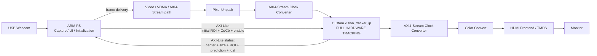

### Tracking ownership

In **General Object Tracking**, software performs the initial object selection and threshold learning, writes the starting configuration to the FPGA, and then continues delivering frames. From that point onward, the evolving tracking state is owned by the PL.

In **Validated Hand Tracking**, the PS adds periodic high-level validation or reacquisition, but the same FPGA tracker continues to perform the frame-by-frame tracking between those events.

The detailed hardware processing sequence is described in the FPGA Processing Pipeline section below.

---

## Hardware / Software Partitioning

| Function | PS / ARM | PL / FPGA |
|---|:---:|:---:|
| USB camera capture / frame delivery | ✓ | |
| User interface | ✓ | |
| Initial object selection | ✓ | |
| Initial Cr/Cb threshold learning | ✓ | |
| Palm acquisition in validated-hand mode | ✓ | |
| Optional periodic high-level validation | ✓ | |
| RGB → YCrCb conversion | | **✓** |
| Current ROI test for every pixel | | **✓** |
| Cr/Cb object classification | | **✓** |
| 5×5 mask cleanup | | **✓** |
| Bounding-box measurement | | **✓** |
| Pixel counting | | **✓** |
| Centroid / object-center calculation | | **✓** |
| Dynamic acceptance threshold | | **✓** |
| Velocity calculation | | **✓** |
| Velocity smoothing | | **✓** |
| Motion prediction | | **✓** |
| Adaptive ROI position update | | **✓** |
| Adaptive ROI size update | | **✓** |
| Lost-object detection | | **✓** |
| Direction-aware loss expansion | | **✓** |
| Hardware tracking state | | **✓** |
| Debug-video generation | | **✓** |
| Initial configuration / status access | AXI-Lite | AXI-Lite |

> **In other words:** software can seed, observe or validate the tracker, but it does not continuously track the object. The frame-by-frame tracker is hardware.

---

# FPGA / PL Design

## Fully Autonomous Frame-by-Frame Hardware Tracking

The most important engineering feature of this project is that the FPGA does more than accelerate one image-processing function. It contains the **complete tracking feedback loop**.

A software-assisted tracker could use the FPGA only for thresholding or filtering and then send the result back to Python for object-center calculation and ROI movement. This design deliberately does **not** do that.

Instead, the feedback path closes inside the PL:

```text
incoming frame
    ↓
hardware segmentation
    ↓
hardware mask cleaning
    ↓
hardware object measurement
    ↓
hardware center calculation
    ↓
hardware velocity / prediction
    ↓
hardware ROI update
    ↓
next frame uses the new hardware ROI
```

Therefore, once the initial configuration has been written, the ROI used on frame **N+1** is generated from the measurements of frame **N** without requiring a Python/OpenCV tracking calculation in between.

The PS may read the published hardware state for display, diagnostics or validation, but those reads are **observational**. They are not required to calculate the normal next tracking state.

---

## FPGA Processing Pipeline

The custom tracker is composed of a sequence of VHDL blocks:

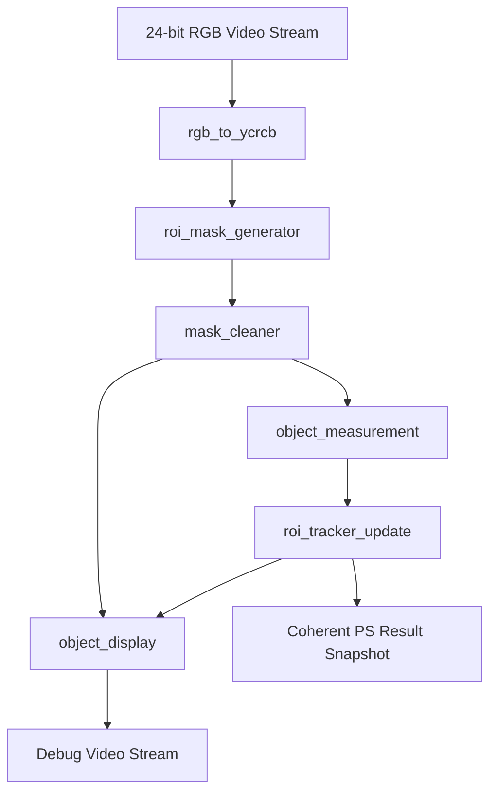

> **TODO — Add polished FPGA pipeline figure here**  
> Suggested file: `docs/fpga_pipeline.png`

### 1. `rgb_to_ycrcb.vhd`

Converts each 24-bit RGB pixel to YCrCb using fixed-point integer arithmetic:

```text
Y  = ( 77R + 150G +  29B) >> 8
Cb = ((-43R - 85G + 128B) >> 8) + 128
Cr = ((128R -107G - 21B) >> 8) + 128
```

The conversion is performed in one clock stage and the final Y, Cr and Cb values are registered at the output.

Only **Cr and Cb** are required by the object-classification stage.

### 2. `roi_mask_generator.vhd`

Tracks the coordinates of the incoming raster and produces a one-bit object mask.

A pixel is classified as part of the target only when:

```text
pixel is inside the current ROI
AND cr_min <= Cr <= cr_max
AND cb_min <= Cb <= cb_max
```

Pixels outside the ROI are forced to zero. Limiting classification to the current ROI reduces the search region and prevents unrelated areas of the frame from participating in the measurement.

### 3. `mask_cleaner.vhd`

Applies a generic odd-sized majority filter to the binary mask.

The current top-level configuration uses:

```text
Kernel:              5 × 5
Window pixels:       25
Majority threshold:  13
```

The module uses line buffers and a sliding window. After the initial raster-alignment delay, it supports **one output pixel for every valid input pixel**.

The output is re-aligned to a complete frame raster so downstream blocks do not need to compensate for the filter offset.

### 4. `object_measurement.vhd`

Calculates object statistics from the cleaned mask:

- minimum and maximum X/Y coordinates,
- bounding-box width and height,
- matching-pixel count,
- centroid X and Y.

The implementation separates the work into two clocked processes:

1. A frame accumulator collects statistics for the current frame.
2. Two sequential dividers calculate centroid X and Y from the completed-frame snapshot.

While centroid division is being performed for one completed frame, the accumulator can already begin collecting the next frame.

### 5. `roi_tracker_update.vhd`

This block contains the main hardware tracking state machine.

At the end of each measured frame the tracker chooses between two paths:

#### ACCEPT

If enough matching pixels were detected, the measurement is accepted. The tracker then:

1. stores the new measured center and size,
2. calculates raw X/Y velocity,
3. clamps velocity to `±VEL_MAX`,
4. smooths velocity with the previous accepted velocity,
5. predicts the next object center,
6. increases ROI padding according to movement speed,
7. builds a tight ROI around the predicted position,
8. atomically publishes the completed tracking state.

Current velocity limit:

```text
VEL_MAX = 120 pixels/frame
```

Velocity smoothing:

```text
smoothed_velocity = (raw_velocity + previous_smoothed_velocity) / 2
```

Prediction:

```text
predicted_center = measured_center + smoothed_velocity
```

Current normal-tracking ROI parameters:

```text
Base padding:          8 px
Maximum padding:      40 px
Maximum tracking ROI: 200 × 200 px
```

Padding grows with speed:

```text
padding = clamp(PAD_BASE + abs(smoothed_velocity) / 2,
                0,
                PAD_MAX)
```

#### LOSS

If too few matching pixels are present, `tracking_lost` is asserted.

Instead of blindly making another full prediction without a new measurement, the PL expands the ROI that is already centered around the previous prediction. Expansion is **direction-aware**: more search area is added in the last known direction of motion.

The expansion also increases with consecutive missed frames through a loss ramp.

Current loss-search limits:

```text
LOSS_BASE:             10 px
LOSS_RAMP:              5 px per loss update
LOSS_MIN:               5 px
LOSS_MAX:              40 px
Maximum loss ROI:      240 × 240 px
```

The ROI therefore grows only as needed and remains bounded.

### Timing-oriented tracker pipelining

The tracker state update was deliberately split across multiple clock cycles rather than placing the complete decision path into one long combinational calculation.

For an accepted measurement, `roi_tracker_update` progresses through four registered stages:

```text
ACCEPT_VELOCITY
      ↓
ACCEPT_PREDICT
      ↓
ACCEPT_ROI
      ↓
ACCEPT_COMMIT
```

The stages separate the major calculations:

1. **Velocity stage** — raw X/Y velocity is calculated, limited to `±VEL_MAX`, and smoothed.
2. **Prediction stage** — the next object center and speed-dependent padding are calculated.
3. **ROI stage** — the next ROI width and height are formed and constrained.
4. **Commit stage** — the new ROI position and completed tracking state are published atomically.

Loss handling is also pipelined:

```text
TRACKER_IDLE
      ↓
LOSS_EXPAND
      ↓
LOSS_COMMIT
```

This separates the requested loss expansion from the final bounded ROI update and avoids building a single long combinational loss-recovery path.

The same timing-oriented design philosophy is used in `object_measurement`: frame accumulation is independent from centroid division, and X/Y centroids are calculated by two small sequential dividers in parallel. While the completed frame is being divided, accumulation for the following frame can already continue.

### Dynamic acceptance threshold

After an accepted object measurement, the required matching-pixel count for the next frame is derived from the measured object size:

```text
min_accepted_pixels = max(
    150,
    object_width × object_height / 8
)
```

This gives the tracker a minimum noise floor while allowing the acceptance threshold to scale with the tracked object.

### 6. `object_display.vhd`

Generates a hardware debug image with a black background and overlays the current tracking state:

- cleaned mask — white,
- ROI border — green,
- measured center — red `+`,
- predicted center — blue `X`.

The current display parameters are:

```text
ROI border thickness: 2 px
Center-marker radius: 4 px
```

### 7. `vision_tracker_logic_top.vhd`

Structurally connects the complete tracker pipeline and creates a coherent result snapshot for the PS.

All PS-facing tracking outputs are captured together only after `roi_tracker_update` has completed the frame update. A 32-bit snapshot counter is incremented whenever a new coherent result becomes available.

This allows software to determine whether a fresh result exists without reading a partially updated set of registers.

### 8. `vision_tracker_pkg.vhd`

`vision_tracker_pkg.vhd` is the central compile-time configuration package for resolution-dependent tracker parameters.

Current configuration:

```vhdl
constant FRAME_WIDTH  : positive := 640;
constant FRAME_HEIGHT : positive := 480;
constant VEL_MAX      : positive := 120;
```

Changing the frame dimensions in this package causes the required internal widths to be derived automatically at elaboration time, including:

- X/Y coordinate widths,
- ROI width/height widths,
- full-frame pixel-count width,
- X/Y centroid accumulator widths,
- signed predicted-center widths.

For example, the predicted-center width is automatically large enough to represent positions temporarily outside the visible frame by up to `VEL_MAX`.

This makes the hardware architecture reusable: the designer changes the central frame configuration and rebuilds the FPGA instead of manually updating width declarations throughout every VHDL module.

### Hardware tuning parameters

Algorithmic tuning values are also centralized at the integration boundary through the generic map of `roi_tracker_update`.

The current build uses:

```text
PAD_BASE       = 8
PAD_MAX        = 40
MAX_TRACK_ROI  = 200 × 200
COUNT_FLOOR    = 150
COUNT_SHIFT    = 3
LOSS_BASE      = 10
LOSS_RAMP      = 5
LOSS_MIN       = 5
LOSS_MAX       = 40
MAX_LOSS_ROI   = 240 × 240
```

These values control the physical behavior of the hardware tracker: how tightly it follows the target, how the acceptance threshold scales, how far it predicts, and how aggressively it expands the search region after a missed frame.

They are **compile-time hardware parameters**. Changing them means rebuilding the PL implementation, while runtime object-specific values such as the initial ROI and Cr/Cb thresholds are written by the PS through AXI-Lite.

The main edit points are:

- `PL/src/vision_tracker_pkg.vhd` — frame dimensions, `VEL_MAX`, and automatically derived widths.
- `PL/src/vision_tracker_logic_top.vhd` — the `roi_tracker_update` generic map used to tune padding, ROI limits, acceptance thresholds and loss behavior.

This separation gives the design two useful configuration levels:

| Configuration type | Examples | How it is changed |
|---|---|---|
| **Compile-time PL architecture / tuning** | frame size, `VEL_MAX`, padding, maximum ROI sizes, loss behavior | VHDL package / generics → rebuild bitstream |
| **Runtime object configuration** | tracking enable, initial ROI, Cr/Cb thresholds | PS → AXI-Lite registers |


---

## Why This Architecture Fits an FPGA

The tracker combines two workloads that map naturally to programmable logic:

- **Per-pixel streaming work** — color conversion, ROI tests, thresholding and mask filtering can operate continuously as pixels arrive.
- **Frame-level state updates** — object measurement, motion estimation, prediction and ROI updates are deterministic and can be implemented as registered state-machine stages.
- **Local feedback** — the ROI generated from frame N is already available in hardware for frame N+1, without a software round trip.

The PS is therefore reserved for tasks where software flexibility is more useful: camera interfacing, initialization, user interaction, diagnostics and optional high-level validation.

---

## AXI Interfaces

The custom IP exposes two different interfaces for two different roles.

### AXI4-Stream Video

The video interface transports 24-bit RGB pixels and standard video-stream synchronization:

- `tdata` — RGB pixel data,
- `tvalid` — valid pixel,
- `tuser` — start of frame,
- `tlast` — end of line,
- `tready` — back-pressure / flow control.

The tracker produces a second AXI4-Stream carrying the generated debug video.

### AXI-Lite Control and Status

The PS controls and observes the tracker through a 32-bit AXI-Lite register interface.

Current software base address:

```text
0x43C30000
```

#### Register map

| Offset | Direction | Register | Description |
|---:|:---:|---|---|
| `0x00` | PS → PL | `TRACKING_CONTROL` | Bit 0 enables tracking |
| `0x04` | PL → PS | `TRACKING_STATUS` | Bit 0 = tracking lost |
| `0x08` | PL → PS | `SNAPSHOT_COUNTER` | Increments on each coherent published result |
| `0x0C` | PL → PS | `FRAME_WIDTH` | Hardware frame width |
| `0x10` | PL → PS | `FRAME_HEIGHT` | Hardware frame height |
| `0x14` | PS → PL | `INITIAL_ROI_X` | Initial ROI X |
| `0x18` | PS → PL | `INITIAL_ROI_Y` | Initial ROI Y |
| `0x1C` | PS → PL | `INITIAL_ROI_WIDTH` | Initial ROI width |
| `0x20` | PS → PL | `INITIAL_ROI_HEIGHT` | Initial ROI height |
| `0x24` | PS → PL | `OBJECT_THRESHOLDS` | Packed Cr/Cb bounds |
| `0x28` | PL → PS | `OBJECT_CENTER_X` | Measured centroid X |
| `0x2C` | PL → PS | `OBJECT_CENTER_Y` | Measured centroid Y |
| `0x30` | PL → PS | `OBJECT_WIDTH` | Measured object width |
| `0x34` | PL → PS | `OBJECT_HEIGHT` | Measured object height |
| `0x38` | PL → PS | `OBJECT_PIXEL_COUNT` | Number of matching pixels |
| `0x3C` | PL → PS | `TRACKING_ROI_X` | Current ROI X |
| `0x40` | PL → PS | `TRACKING_ROI_Y` | Current ROI Y |
| `0x44` | PL → PS | `TRACKING_ROI_WIDTH` | Current ROI width |
| `0x48` | PL → PS | `TRACKING_ROI_HEIGHT` | Current ROI height |
| `0x4C` | PL → PS | `PREDICTED_CENTER_X` | Signed predicted X |
| `0x50` | PL → PS | `PREDICTED_CENTER_Y` | Signed predicted Y |

The four 8-bit object thresholds are packed into `0x24` as:

```text
bits  7:0   = Cr min
bits 15:8   = Cr max
bits 23:16  = Cb min
bits 31:24  = Cb max
```

### Coherent snapshot reads

`fpga.py` reads the snapshot counter before and after the complete status-register group. If the counter changes during the read, software retries so that the returned `TrackingData` corresponds to one coherent PL snapshot.

The number of retries is bounded so software cannot be permanently blocked by a rapidly updating producer.

---

## Vivado Integration

The VHDL tracking logic is packaged as a custom Vivado IP containing:

- AXI4-Stream video input (`S_AXIS_VIDEO`),
- processed/debug AXI4-Stream video output (`VIDEO_OUT`),
- AXI-Lite control/status interface (`S_AXI_TRACK`),
- and the complete internal VHDL tracking pipeline.

The repository includes the generated PYNQ overlay files:

```text
PL/design_1.bit
PL/design_1.hwh
```

### Custom tracker integration into the HDMI output pipeline

<p align="center">
  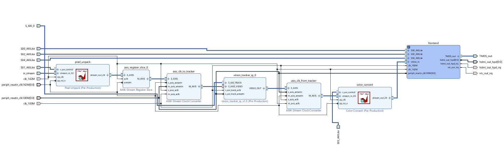
</p>

The figure above shows the **actual Vivado integration** of `vision_tracker_ip_0` inside the HDMI output subsystem.

The main streaming path is:

```text
in_stream
   ↓
pixel_unpack
   ↓
axis_register_slice_0
   ↓
axis_clk_to_tracker
   ↓
vision_tracker_ip_0
   ↓
axis_clk_from_tracker
   ↓
color_convert
   ↓
HDMI frontend
   ↓
TMDS_out
```

The custom tracker is therefore not a detached software accelerator. It is physically inserted **in-line in the FPGA video stream**.

#### 1. Pixel unpacking

`pixel_unpack` converts the incoming packed video stream to the 24-bit pixel stream used by the processing path.

#### 2. Stream buffering

`axis_register_slice_0` provides an AXI4-Stream register stage before the custom tracker path.

#### 3. Clock-domain transfer into the tracker

`axis_clk_to_tracker` safely transfers the AXI4-Stream video into the clock domain used by `vision_tracker_ip_0`.

#### 4. Full tracking inside `vision_tracker_ip_0`

From this point, the custom IP owns the continuous tracking computation. Its internal VHDL pipeline is the one described earlier in **FPGA Processing Pipeline**, ending with a hardware-generated ROI/state update for the following frame.

The software does **not** receive each frame, calculate the object center, and send a new ROI back to the FPGA. The ROI controller itself is VHDL logic inside the tracker.

#### 5. Clock-domain transfer back to the HDMI path

The processed output stream leaves the custom IP through `VIDEO_OUT` and passes through `axis_clk_from_tracker`.

#### 6. HDMI output formatting

The stream is passed through `color_convert` and then into the HDMI frontend, which ultimately drives the PYNQ-Z2 physical TMDS output and the connected monitor.

### AXI-Lite control path

The tracker also exposes `S_AXI_TRACK`, independent of the pixel stream.

The PS uses this interface to provide initial configuration and to read status. The tracker is memory-mapped at:

```text
0x43C30000
```

This control path carries configuration/status only. **The continuous tracking datapath does not run through the ARM processor.**

### Clock domains and tracker operating frequency

The block design contains multiple clock domains. The custom `vision_tracker_ip` was integrated in a dedicated **100 MHz tracking clock domain**, while the surrounding video infrastructure also uses a **142 MHz** domain.

The two AXI4-Stream clock converters surrounding the tracker provide the required clock-domain crossings:

```text
video / HDMI domain
        ↓
axis_clk_to_tracker
        ↓
100 MHz tracking domain
        ↓
vision_tracker_ip_0
        ↓
axis_clk_from_tracker
        ↓
video / HDMI domain
```

Using a dedicated 100 MHz tracker domain, together with registered pipeline stages inside the VHDL design, keeps the continuous hardware tracking path compatible with the implemented timing constraints.

> **Hardware integration result:** camera frames may be delivered by software into the PYNQ video infrastructure, but once the pixel stream enters the custom tracker, segmentation, measurement, center calculation, prediction, ROI control, loss recovery and debug rendering are all performed autonomously in PL.

> **TODO — Add full top-level Vivado Block Design screenshot here**  
> Suggested file: `docs/vivado_block_design.png`

---

# Operating Modes

## 1. General Object Tracking

<p align="center">
  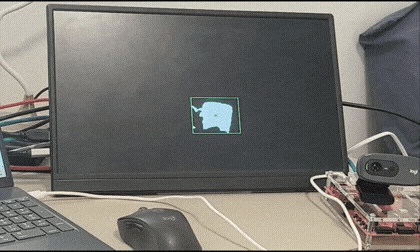
  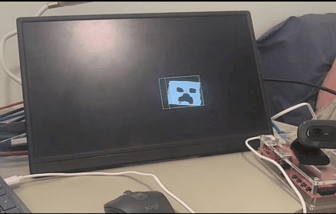
</p>

<p align="center"><i>Two examples of the general-purpose FPGA tracker following different user-selected objects.</i></p>

Directory:

```text
PS/GENERAL_OBJECT_TRACKING/
```

Main runtime:

```text
run_object_tracker_pynq.py
```

This is the cleanest demonstration of the hardware tracker.

### Flow

1. The PS displays the live USB-camera preview.
2. The user captures one frame.
3. The user draws an initial ROI around the target object.
4. The PS learns Cr/Cb limits from the central region of that selected object.
5. The PS writes the initial ROI and thresholds to the FPGA.
6. Tracking is enabled.
7. From this point, the PS continues to deliver video frames, but **the continuous tracking state is owned by the PL**.
8. For every new frame, the PL independently performs segmentation, filtering, object measurement, centroid calculation, velocity estimation, prediction, ROI movement/resizing and loss recovery.
9. The ROI calculated by the PL is automatically used for the following frame without a software tracking decision in between.

> **General-object mode is the clearest demonstration of the hardware architecture:** after initialization, software does not continuously calculate where the object is or where the next ROI should be.

The current initialization algorithm uses:

```text
Central ROI fraction:      0.72
Low percentile:            5%
High percentile:          95%
Cr/Cb margin:               6
Minimum color samples:     10
```

The purpose of the percentile limits is to reject color outliers before expanding the final Cr/Cb range by the configured margin.

### Initial ROI selection examples

The general-object mode begins with a one-time user selection of the target ROI. The PS then learns the initial Cr/Cb range from the selected object and seeds the hardware tracker.

<table>
  <tr>
    <td width="50%" align="center">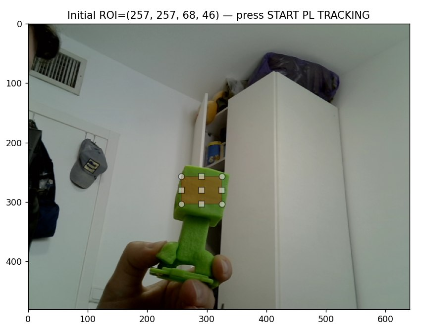</td>
    <td width="50%" align="center">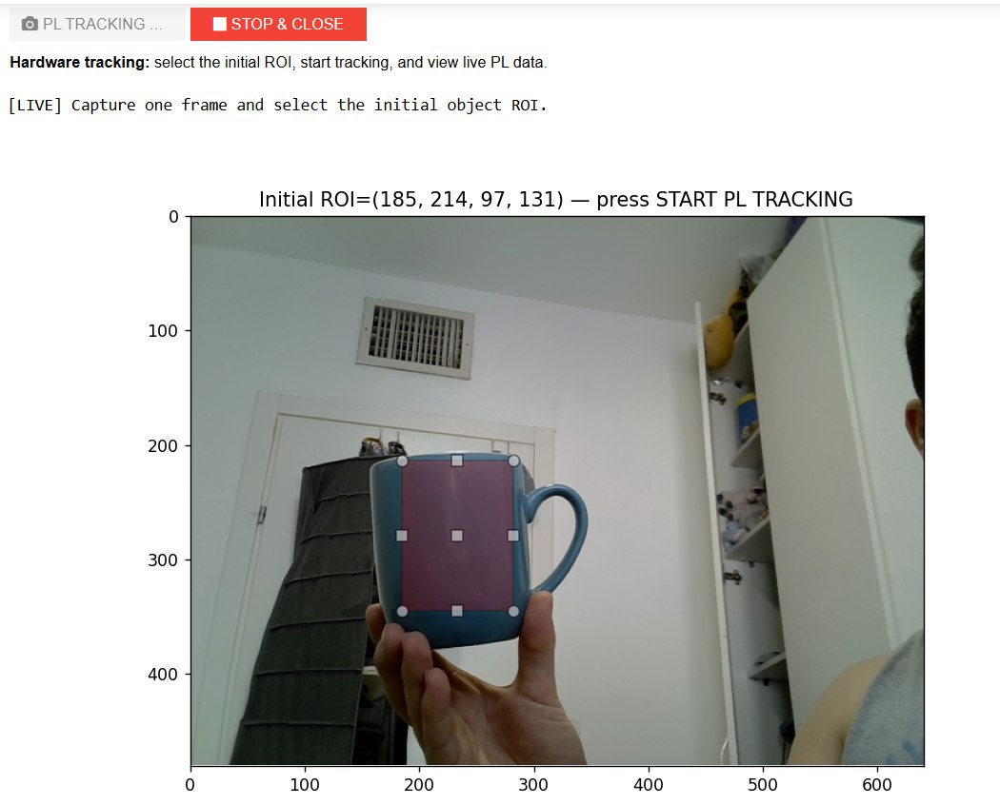</td>
  </tr>
  <tr>
    <td align="center"><b>Initial ROI — Example 1</b></td>
    <td align="center"><b>Initial ROI — Example 2</b></td>
  </tr>
</table>

### Live PL tracking data

During operation, the notebook can display the current hardware state read from the tracker through AXI-Lite, including the published snapshot number, measured object center and size, pixel count, current ROI, predicted center and loss state.

<p align="center">
  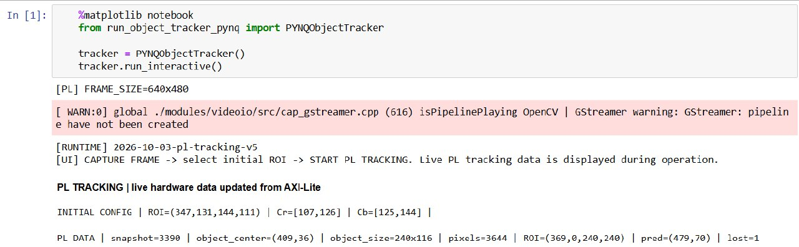
</p>

---

## 2. Validated Hand Tracking

<p align="center">
  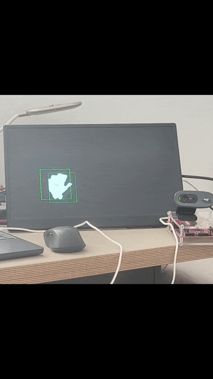
</p>

<p align="center"><i>The same FPGA tracking engine combined with PS-side palm acquisition and periodic high-level validation.</i></p>

Directory:

```text
PS/VALIDATED_HAND_TRACKING/
```

Main runtime:

```text
run_tracker.py
```

This mode demonstrates how the same hardware tracker can be combined with a higher-level software detector.

The included `palm.onnx` model is used for **acquisition and validation**, not for continuous frame-by-frame tracking.

### Flow

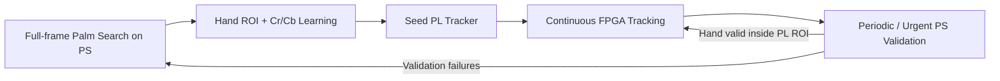

The PS:

1. finds a hand using `palm.onnx`,
2. derives an ROI and Cr/Cb thresholds,
3. seeds the PL tracker,
4. performs asynchronous validation approximately once per second,
5. requests urgent validation when a fresh PL snapshot reports `tracking_lost = 1`.

Healthy tracking is intentionally left alone: a successful validation does **not** continuously overwrite the PL ROI.

Palm inference runs in a background worker so it does not block the camera-to-video-to-PL path.

Current validation interval:

```text
1.0 second
```

### PS/PL validation status

The validated-hand runtime exposes the interaction between the software validator and the continuously running PL tracker. The status output below shows PS search/lock/validation events together with the current FPGA snapshot and tracking state.

<p align="center">
  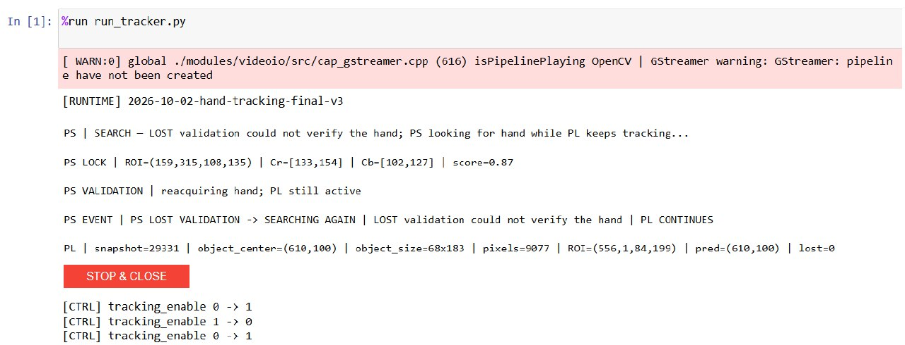
</p>

---

# Hardware Setup

## Required Hardware

- **PYNQ-Z2** development board
- **USB webcam**
- **Ethernet cable** between the PYNQ-Z2 and the computer
- **HDMI cable** for the video output
- **Monitor/display with HDMI input** for displaying the tracking result
- USB cable for the board's serial/UART connection
- Computer running Windows
- PYNQ-compatible SD card/image

## Required Software

On the computer:

- PuTTY or another serial terminal
- Web browser

On the PYNQ image / runtime:

- PYNQ Python environment
- OpenCV (`cv2`)
- NumPy
- Jupyter / IPython widgets used by the interactive interface

The validated-hand mode also uses OpenCV DNN to load the included `palm.onnx` model.

---

# Connecting to the PYNQ-Z2

The following procedure is intended for a direct Ethernet connection between a Windows computer and the PYNQ-Z2.

## Step 1 — Find the COM Port

1. Connect the PYNQ-Z2 to the computer through its serial/UART USB connection.
2. Press **Windows + X**.
3. Open **Device Manager**.
4. Open **Ports (COM & LPT)**.
5. Identify the COM port assigned to the PYNQ-Z2, for example:

```text
COM3
```

The exact COM number may be different on every computer.

## Step 2 — Open a Serial Session in PuTTY

Open PuTTY and configure:

```text
Connection type: Serial
Serial line:     COMx
Speed:           115200
```

Replace `COMx` with the COM port found in Device Manager.

Click **Open**.

Press **Enter** until the PYNQ terminal prompt appears, then run:

```bash
ifconfig eth0
```

Find the IPv4 address shown next to `inet`.

For example:

```text
inet 192.168.2.99
```

In this example the board's Ethernet address is:

```text
192.168.2.99
```

## Step 3 — Configure the Computer's Ethernet Address

Open the Windows settings for the Ethernet adapter and configure IPv4 manually.

The computer and PYNQ-Z2 must be on the **same subnet**, but they must **not use the same IP address**.

For example, if the board reports:

```text
PYNQ-Z2: 192.168.2.99
```

configure the computer as:

```text
IP address:  192.168.2.1
Subnet mask: 255.255.255.0
Gateway:     leave blank
DNS:         leave blank
```

So the direct connection becomes:

```text
Computer: 192.168.2.1
PYNQ-Z2:  192.168.2.99
```

If the board reports a different subnet, choose a free computer address in that same subnet instead.

## Step 4 — Open the PYNQ Web Interface

In a browser, open:

```text
http://pynq:9090
```

If prompted for the default PYNQ password:

```text
xilinx
```

If the hostname `pynq` does not resolve, use the board IP found with `ifconfig`, for example:

```text
http://192.168.2.99:9090
```

---

# Running the Project on the Board

## Prepare the Overlay Files

Both runtime scripts expect the matching `.bit` and `.hwh` files to be **in the same directory as the Python runtime**.

The repository stores the master copies under:

```text
PL/design_1.bit
PL/design_1.hwh
```

Before running a mode, place both files next to that mode's script.

### General Object Tracking directory should contain

```text
PS/GENERAL_OBJECT_TRACKING/
├── fpga.py
├── run_object_tracker_pynq.py
├── design_1.bit
└── design_1.hwh
```

### Validated Hand Tracking directory should contain

```text
PS/VALIDATED_HAND_TRACKING/
├── fpga.py
├── mp_palmdet.py
├── palm.onnx
├── run_tracker.py
├── design_1.bit
└── design_1.hwh
```

The `.bit` and `.hwh` files must be the matching pair generated from the same Vivado design.

---

## Run General Object Tracking

Open a Jupyter notebook in:

```text
PS/GENERAL_OBJECT_TRACKING/
```

Run:

```python
%matplotlib notebook
from run_object_tracker_pynq import PYNQObjectTracker

tracker = PYNQObjectTracker()
tracker.run_interactive()
```

### User flow

1. Wait for the live camera preview.
2. Click **CAPTURE FRAME**.
3. Draw a rectangle around the object to track.
4. Confirm the ROI and start tracking.
5. Observe the live PL status and hardware debug output.
6. Use **STOP & CLOSE** for a clean shutdown.

Once tracking has started, the continuous tracker is running in the PL.

---

## Run Validated Hand Tracking

Open a Jupyter notebook in:

```text
PS/VALIDATED_HAND_TRACKING/
```

Run:

```python
%run run_tracker.py
```

The runtime automatically starts full-frame hand search. After a valid hand is acquired, it learns the hand's chrominance limits, seeds the FPGA tracker and enters continuous PL tracking with periodic PS validation.

---

# Hardware-Matched PC Simulation

The repository also contains:

```text
full_system_simulation.py
```

The simulator reproduces the current tracking algorithm at frame level and is intended for algorithm tuning before committing new constants to VHDL and rebuilding the FPGA design.

It models:

```text
rgb_to_ycrcb
      ↓
roi_mask_generator
      ↓
mask_cleaner
      ↓
object_measurement
      ↓
roi_tracker_update
      ↓
object_display
```

The default `HWConfig` values match the current VHDL top-level configuration.

### Run with a webcam

```bash
python full_system_simulation.py
```

or choose another camera:

```bash
python full_system_simulation.py --camera 1
```

### Run with a recorded video

```bash
python full_system_simulation.py --video path/to/video.mp4
```

### Controls

```text
S       Select / reselect object
R       Reset tracking
Q / ESC Quit
```

The simulator opens two useful windows:

- **SIM DEBUG** — original camera image plus diagnostic information.
- **REAL SYSTEM - exact PL HDMI** — software rendering of the expected hardware debug output.

> **TODO — Add simulation screenshot here**  
> Suggested file: `docs/hardware_matched_simulation.png`

This simulation was used as a development tool for changing tracking parameters quickly before transferring the selected values back into the VHDL implementation.

---

# Current Hardware Configuration

| Parameter | Current value |
|---|---:|
| Frame width | 640 px |
| Frame height | 480 px |
| Mask-cleaner kernel | 5 × 5 |
| Majority threshold | 13 / 25 |
| Velocity limit (`VEL_MAX`) | 120 px/frame |
| Normal ROI base padding | 8 px |
| Normal ROI maximum padding | 40 px |
| Maximum normal-tracking ROI | 200 × 200 px |
| Pixel-count floor | 150 |
| Pixel-count area divisor | 8 |
| Loss base expansion | 10 px |
| Loss ramp | 5 px/update |
| Loss expansion clamp | 5–40 px |
| Maximum loss ROI | 240 × 240 px |
| Debug ROI border | 2 px |
| Center-marker radius | 4 px |

## Changing the Hardware Configuration

The tracker was designed so that important hardware parameters can be changed without rewriting the complete design.

### Resolution and width-dependent parameters

Edit:

```text
PL/src/vision_tracker_pkg.vhd
```

For example:

```vhdl
constant FRAME_WIDTH  : positive := 640;
constant FRAME_HEIGHT : positive := 480;
constant VEL_MAX      : positive := 120;
```

The package automatically derives the dependent coordinate, size, pixel-count, accumulator and prediction widths.

### Tracking-behavior parameters

The `roi_tracker_update` generic map in `vision_tracker_logic_top.vhd` controls values such as:

- normal ROI padding,
- maximum normal ROI size,
- minimum accepted-pixel floor,
- area scaling of the acceptance threshold,
- loss expansion base/ramp,
- maximum loss expansion,
- maximum loss ROI dimensions.

This makes it possible to tune the behavior for a different application and then synthesize a new hardware implementation.

### Runtime parameters

Object-specific values do not require a new bitstream. The PS can write:

- tracking enable,
- initial ROI X/Y/W/H,
- Cr minimum/maximum,
- Cb minimum/maximum.

After these values seed the tracker, the evolving center, prediction and ROI are once again generated by the PL.

---


# FPGA Implementation Results

The final Vivado implementation confirms that the complete system — including the PYNQ video infrastructure and the custom hardware tracker — fits comfortably in the Zynq-7000 device and meets the specified timing constraints.

## Operating Frequency

The custom `vision_tracker_ip` operates in a dedicated **100 MHz FPGA clock domain**.

The surrounding video design also contains a **142 MHz** clock domain, so AXI4-Stream clock converters are used before and after the custom tracker to cross between the video and tracking domains safely.

## Timing Closure

Post-implementation Vivado analysis confirmed that **all user-specified timing constraints are met**, with no failing setup or hold endpoints.

Timing closure was treated as an architectural requirement during the VHDL design rather than as a final cleanup step. Several computationally heavier operations were deliberately split across registered stages so that the tracker would not depend on long combinational paths.

For example, the accepted-frame update in `roi_tracker_update` is pipelined across separate stages for:

```text
Velocity calculation
        ↓
Prediction
        ↓
ROI sizing
        ↓
State / ROI commit
```

The loss-recovery path is also split into separate expansion and commit stages.

In `object_measurement`, frame accumulation is separated from centroid division. After one frame has been accumulated, the X and Y centroid calculations proceed using sequential dividers while the next frame can already begin accumulating.

Together with the dedicated **100 MHz tracking clock domain** and the AXI4-Stream clock-domain converters surrounding the tracker, these design choices allowed the implemented system to meet its timing requirements.

## Full-System FPGA Resource Utilization

The resource figures below represent the **complete implemented PYNQ-Z2 design**, not only `vision_tracker_ip`.

They include the video/HDMI infrastructure, AXI interconnects, clocking logic, VDMA-related logic, control infrastructure and the custom hardware tracker.

<p align="center">
  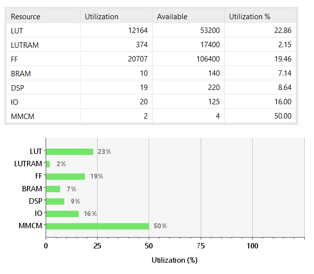
</p>

Despite including the complete video and control infrastructure, the implemented design uses less than one quarter of the available LUT and FF resources and less than 10% of the available BRAM and DSP resources.

This leaves substantial programmable-logic capacity for future extensions such as additional image features, multiple-object support or further hardware acceleration.

---

# Repository Structure

```text
pynq_z2_object_tracking_system/
│
├── PL/
│   ├── design_1.bit
│   ├── design_1.hwh
│   │
│   ├── hdl/
│   │   ├── vision_tracker_ip.vhd
│   │   └── vision_tracker_ip_slave_lite_v1_0_S_AXI_TRACK.vhd
│   │
│   └── src/
│       ├── mask_cleaner.vhd
│       ├── object_display.vhd
│       ├── object_measurement.vhd
│       ├── rgb_to_ycrcb.vhd
│       ├── roi_mask_generator.vhd
│       ├── roi_tracker_update.vhd
│       ├── vision_tracker_logic_top.vhd
│       └── vision_tracker_pkg.vhd
│
├── PS/
│   ├── GENERAL_OBJECT_TRACKING/
│   │   ├── fpga.py
│   │   └── run_object_tracker_pynq.py
│   │
│   └── VALIDATED_HAND_TRACKING/
│       ├── fpga.py
│       ├── mp_palmdet.py
│       ├── palm.onnx
│       └── run_tracker.py
│
├── docs/
│   ├── general_object1.gif
│   ├── general_object_2.gif
│   ├── hand.gif
│   ├── general_object_initial_roi_green_object.jpg
│   ├── general_object_initial_roi_mug.jpg
│   ├── general_object_pl_tracking_data.jpg
│   ├── validated_hand_tracking_status.jpg
│   ├── hdmi_tracker_integration.png
│   └── full_system_fpga_utilization.png
│
├── full_system_simulation.py
└── README.md
```

---

# Limitations

The current tracker is intentionally lightweight and hardware-oriented. Its main limitations are:

- The target is represented primarily by **Cr/Cb chrominance ranges**, so a visually similar object entering the active ROI may also match.
- Large illumination or appearance changes can make the original learned threshold range less representative.
- Normal tracking and loss-recovery ROI sizes are intentionally bounded.
- The current implementation tracks one target at a time.
- General-object initialization still requires the user to select the first ROI.
- In validated-hand mode, palm acquisition/validation is a PS-side neural-network operation rather than an FPGA accelerator.
- USB-camera capture is handled by the PS; the project accelerates the tracking pipeline rather than implementing a direct sensor-to-FPGA camera interface.

---

# Future Work

Possible extensions include:

- automatic threshold adaptation while the object appearance changes,
- multiple-object tracking,
- additional hardware features beyond chrominance,
- direct camera-to-PL streaming,
- higher resolutions and additional video formats,
- deeper pipelining / resource optimization after timing analysis,
- FPGA acceleration of the acquisition/validation neural network,
- improved confidence scoring for ambiguous object masks,
- runtime-adjustable tracker parameters through additional AXI-Lite registers.

---

# Remaining Documentation Media

The following engineering visuals can still be added before the final public release:

1. **Physical hardware setup photo** — PYNQ-Z2, USB camera, Ethernet, HDMI cable and display.
2. **FPGA debug-output screenshot** — white mask, green ROI, red measured center and blue predicted center.
3. **Full Vivado Block Design screenshot** — top-level Zynq PS, VDMA/video hierarchy, AXI control and HDMI subsystem.
4. **Polished architecture diagram** — PS/PL partitioning and video/control data paths.
5. **Polished FPGA pipeline diagram** — the VHDL processing stages.
6. **Hardware-matched PC simulation screenshot**.

Recommended filenames:

```text
docs/
├── hardware_setup.jpg
├── hdmi_tracking_output.png
├── vivado_block_design.png
├── system_architecture.png
├── fpga_pipeline.png
└── hardware_matched_simulation.png
```

## Summary

This project implements a **stateful, autonomous FPGA object tracker** on the PYNQ-Z2. Software handles camera interfacing, initialization and optional high-level validation, while the continuous frame-by-frame tracking feedback loop remains in programmable logic.

The result is a hardware-centric vision platform that combines a reusable VHDL tracking pipeline, AXI-based PS/PL integration, HDMI output, configurable tracking behavior and verified post-implementation timing/resource results.
